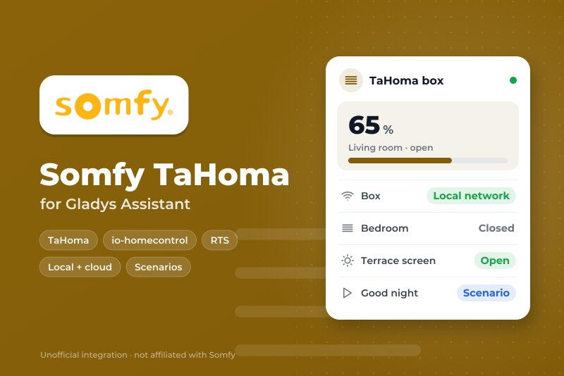
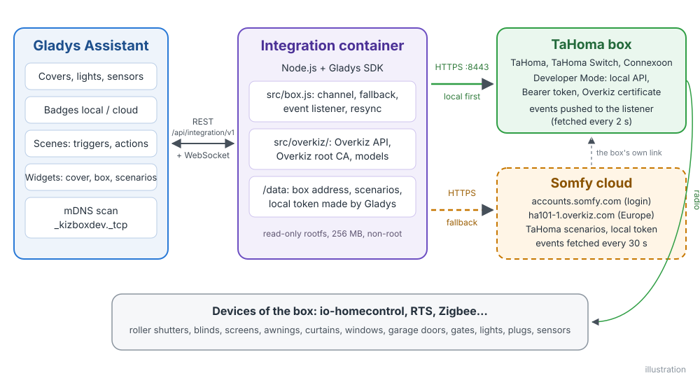
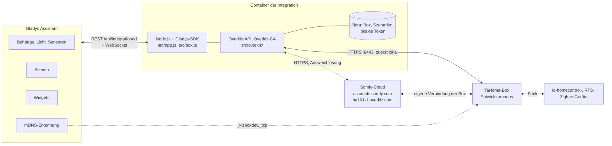
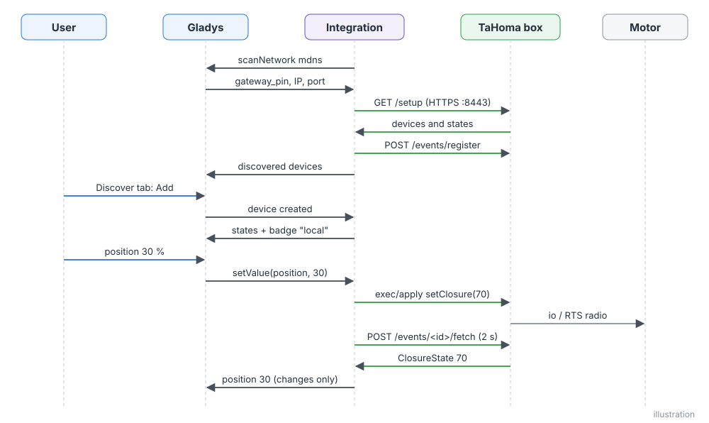
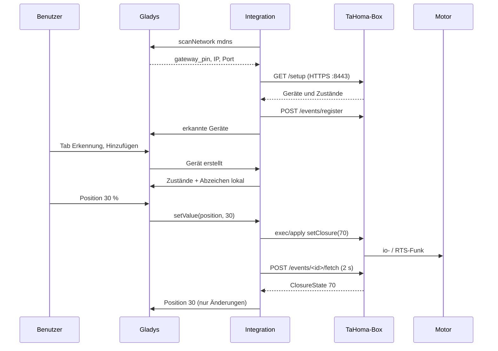
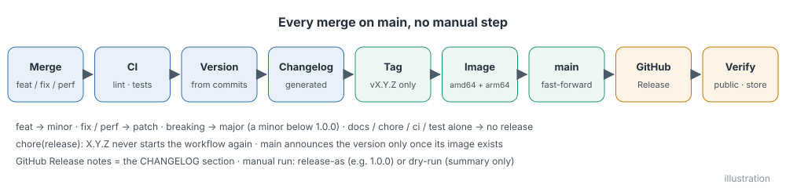

# Somfy TaHoma für Gladys Assistant

[English](README.md) | [Français](README.fr.md) | **Deutsch** | [Español](README.es.md)

[](LICENSE)
[](https://github.com/William-De71/gladys-somfy-tahoma/releases)
[](https://github.com/William-De71/gladys-somfy-tahoma/actions/workflows/release.yml)
[](https://gladysassistant.com)



Ihre Somfy-TaHoma-Box (TaHoma, TaHoma Switch, Connexoon) in Gladys Assistant: Rollläden, Jalousien, Markisen, Vorhänge, Garagentore und Tore, Licht, Steckdosen und Sensoren, im lokalen Netzwerk über den Entwicklermodus oder über die Somfy-Cloud, zuerst lokal mit der Cloud als Ausweichlösung. Inoffiziell, nicht mit Somfy verbunden.

## Funktionen

- **Zwei Kanäle**: die lokale API des Somfy-Entwicklermodus (HTTPS auf Port 8443, Zertifikat gegen die Overkiz-Stammzertifizierungsstelle geprüft) und die Somfy-Cloud (TaHoma-Konto). Der Schalter „Lokale Verbindung bevorzugen“ von Gladys wählt den ersten; der andere dient als Ausweichlösung, angezeigt durch einen orangefarbenen Punkt am Transport-Abzeichen, und der bevorzugte wird alle 5 Minuten erneut versucht.
- **Lokaler Modus mit einem Klick**: Über das TaHoma-Konto schaltet die Konfigurationsschaltfläche den Entwicklermodus der Box ein und erstellt ein lokales Token namens „Gladys Assistant“. Ein in der TaHoma-App erstelltes Token kann auch eingefügt werden.
- **Erkennung**: Die Box wird von der mDNS-Suche von Gladys gefunden (`_kizboxdev._tcp`, PIN im TXT-Eintrag), eine Adresse kann eingegeben werden; jedes Gerät der Box wird im Tab Erkennung angeboten.
- **Behänge** (Zustand, Position, Lamellen, „My“), **Licht** (ein / aus, Helligkeit), **Steckdosen**, **Sensoren** (Temperatur, Lichtstärke, Luftfeuchtigkeit, Öffnung, Bewegung, Rauch, Wasserleck, Batterie, CO2, Leistung, Energiezähler).
- **Gemeldete Zustände**: der Ereignis-Listener der Box, alle 2 s im lokalen Netzwerk abgerufen, alle 30 s in der Cloud (2 s für eine Minute nach einem Befehl); Gladys fragt nichts ab.
- **Drei Dashboard-Widgets**: ein Behang mit seinen Tasten und der „My“-Position, die Box und ihre Behänge auf einen Blick, die TaHoma-Szenarien mit Start-Tasten.
- **Drei Szenen-Auslöser** (ein Befehl ist fehlgeschlagen, ein Gerät antwortet nicht mehr oder wieder, die Box ist weg oder zurück) und **zwei Szenen-Aktionen** (TaHoma-Szenario starten, im lokalen Modus lokal wiedergegeben; einen Befehl wie „My“ senden).
- Englisch, Französisch, Deutsch und Spanisch.

Der Store bietet bereits eine **Overkiz**-Integration ([cicoub13/gladys-overkiz](https://github.com/cicoub13/gladys-overkiz)), nur über die Cloud, die auch Atlantic-Cozytouch-, Flexom-, Rexel- und Hitachi-Konten unterstützt. Diese hier ist den Somfy-Boxen gewidmet und ergänzt den lokalen Modus.

## Funktionsweise





Beide Kanäle sprechen dieselbe „enduser“-API von Overkiz. Die Integration liest `GET /setup` (Geräte und Zustände), registriert einen Ereignis-Listener (`POST /events/register`) und ruft ihn ab (`POST /events/<id>/fetch`); ein Befehl ist eine Ausführung (`POST /exec/apply`). Die Cloud ergänzt die TaHoma-Szenarien (`GET /actionGroups`, `POST /exec/<id>`) und die lokalen Token (`config/<pin>/local/tokens`). Die Anmeldung an der Cloud nutzt die Passwort-Anmeldung der TaHoma-App bei `accounts.somfy.com`, danach ein Bearer-Token, das mit seinem Refresh-Token erneuert wird: Somfy sperrt Konten, die sich zu oft anmelden. Fehler werden wie bei [pyoverkiz](https://github.com/iMicknl/python-overkiz-api) eingeordnet.





### Geräte und Funktionen

| TaHoma-Gerät (uiClass)                                                                             | Gladys-Gerät | Funktionen                                                                                                                             |
| -------------------------------------------------------------------------------------------------- | ------------ | -------------------------------------------------------------------------------------------------------------------------------------- |
| RollerShutter, Shutter, SwingingShutter, Screen, ExteriorScreen, Window, Pergola, GarageDoor, Gate | `shutter`    | `state` (−1 schließen, 0 stopp, 1 öffnen), `position` (wenn gemeldet)                                                                  |
| VenetianBlind, ExteriorVenetianBlind, AdjustableSlatsRollerShutter, Pergola mit Lamellen           | `shutter`    | `state`, `position`, `tilt`                                                                                                            |
| Awning (Markise)                                                                                   | `shutter`    | `state`, `position` (Ausfahrweite)                                                                                                     |
| Curtain (Vorhang)                                                                                  | `curtain`    | `state`, `position`                                                                                                                    |
| Antrieb mit einer Taste (`cycle`)                                                                  | `shutter`    | nur `state`                                                                                                                            |
| RTS-Motor                                                                                          | `shutter`    | `state`, ohne Rückmeldung                                                                                                              |
| Light (Licht)                                                                                      | `light`      | `light` (`binary`), `brightness` wenn dimmbar                                                                                          |
| OnOff, SwimmingPool                                                                                | `switch`     | `switch` (`binary`)                                                                                                                    |
| jedes Gerät mit diesen Zuständen                                                                   | Sensoren     | `temperature`, `luminance`, `humidity`, `contact`, `motion`, `smoke`, `leak`, `battery`, `battery_low`, `co2`, `power`, `energy` (kWh) |

Positionen reichen von 0 % geschlossen bis 100 % offen, wie Gladys sie zählt; Overkiz zählt das Schließen (`core:ClosureState`, umgekehrt) oder das Ausfahren einer Markise (`core:DeploymentState`). Die reservierten Werte 108 („My“) und 124 (unbekannt) sind keine Positionen. Die Wahl der Befehle und Zustände je Behangart folgt der [Overkiz-Integration von Home Assistant](https://github.com/home-assistant/core/tree/dev/homeassistant/components/overkiz). Externe IDs: `ext:<selector>:device:<deviceURL aus Buchstaben, Ziffern und Bindestrichen>` (zum Beispiel `io-1234-5678-9012-12184029`), über beide Kanäle gleich; Funktionen `…:state`, `…:position`, `…:tilt`, `…:light`, `…:brightness`, `…:switch` und die Sensorschlüssel.

Batterien: `battery` liest die Anzeige (`core:BatteryLevelState`), wenn es eine gibt, sonst das Wort von `core:BatteryDiscreteLevelState` (solarbetriebene Velux-Rollläden: good / medium / low / critical) oder `core:BatteryState` (full / normal / medium / low / verylow), umgerechnet in 100 / 75 / 50 / 15 / 5 %; `battery_low` (1 ab low) gibt es nur für diese Wörter. Home Assistant zeigt das Wort, gladys-overkiz nur eine Warnung bei schwacher Batterie: Die Prozentwerte sind eine Schätzung (die Somfy-App zeigt 100 % für „good“). Ein deklariertes, aber nie gefülltes Wort (Velux mit Kabel) ergibt keine Batterie.

## Transport

`transports: ["local", "cloud"]`: Der Katalog zeigt beide Abzeichen und Gladys zeigt den Schalter **Lokale Verbindung bevorzugen** (`GLADYS_PREFER_LOCAL`, standardmäßig an). Jedes Gerät meldet den genutzten Kanal: **lokal**, **Cloud** oder **nicht erreichbar**, wenn keiner antwortet. Wenn der bevorzugte Kanal ausfällt und der andere genutzt wird, trägt das Abzeichen einen **orangefarbenen Punkt** und den Grund (Token abgelehnt, Box nicht gefunden, Zertifikat abgelehnt, falsches Passwort, Anfragelimit…). Im lokalen Modus verlässt nichts das lokale Netzwerk, außer dem stündlichen Lesen der TaHoma-Szenarien, wenn ein Konto eingetragen ist; im Cloud-Modus laufen Befehle und Zustände über Somfy.

## Widgets


- **TaHoma-Behang** (`cover`, Einstellung: ein Behang): Live-Anzeige der Position, Zustand, Lamellen, „My“-Position und die Tasten **Öffnen**, **Stopp**, **My** (die im Motor gespeicherte Lieblingsposition) und **Schließen**; ein Antrieb mit einer Taste zeigt nur eine Taste.
- **TaHoma-Box** (`overview`): die in Gladys hinzugefügten Behänge mit Zustand und Position, der genutzte Kanal, die Firmware, stumme Geräte und eine Taste **Zustände lesen**. Bei mehr als acht Behängen werden sieben gezeigt (fahrende, offene oder stumme zuerst) und eine letzte Karte „+ N weitere(r) Behang/Behänge“ nennt die übrigen. Einstellung `names`: die angezeigten Behänge, Namen durch Kommas getrennt, in dieser Reihenfolge.
- **TaHoma-Szenarien** (`scenarios`, Einstellung: Namen durch Kommas getrennt): die TaHoma-Szenarien und Tasten, um bis zu vier zu starten.

## Szenen-Auslöser und -Aktionen

Auslöser:

- `command_failed` — **Ein TaHoma-Befehl ist fehlgeschlagen**, aus Gladys, der TaHoma-App oder einem TaHoma-Szenario (nie für eine Szenen-Aktion von Gladys). Filter: Gerät. Variablen: `device_name`, `failure_type` (Overkiz-Code, zum Beispiel `WHILEEXEC_BLOCKED_BY_HAZARD`), `label`.
- `device_availability_changed` — **Ein TaHoma-Gerät antwortet nicht mehr oder wieder**. Filter: Gerät, `state` (`available`, `unavailable`). Variable: `device_name`.
- `box_connection_changed` — **Die TaHoma-Box ist weg oder zurück** (kein Kanal eine Minute lang, oder Somfy meldet sie offline). Filter: `state` (`offline`, `online`). Variablen: `transport` (`local`, `cloud`, `none`), `pin`.

Aktionen:

- `run_scenario` — **TaHoma-Szenario starten** über seinen Namen (oder seine ID). In der Cloud: `exec/<id>`; über die lokale API: seine Aktionen mit `exec/apply` wiedergegeben. Ausgaben: `exec_id`, `scenario`, `transport`.
- `send_command` — **TaHoma-Befehl senden** an ein Gerät: `open`, `close`, `stop`, `my`, `identify`. Ausgaben: `exec_id`, `transport`.

Beispiele:

- **Die TaHoma-Box ist weg oder zurück**, `offline` → Nachricht senden „Die TaHoma-Box antwortet nicht mehr“.
- **Ein TaHoma-Befehl ist fehlgeschlagen**, Wohnzimmer-Rollladen → mit `{{triggerEvent.data.failure_type}}` benachrichtigen.
- Bei Sonnenuntergang → **TaHoma-Szenario starten** „Gute Nacht“.

## Voraussetzungen

- Gladys Assistant **5.3.0 oder neuer** (Schalter „Lokale Verbindung bevorzugen“, Katalog-Stichwörter, Widgets und Szenen von Integrationen; ältere Instanzen können die Integration nicht installieren).
- Eine TaHoma-, TaHoma-Switch-, TaHoma-Beecon- oder Connexoon-Box. Lokaler Modus: eine mit dem Entwicklermodus kompatible Box (nicht die erste quadratische TaHoma, nicht das Connectivity Kit) im selben Netzwerk wie Gladys. Cloud und Szenarien: das Konto der TaHoma-App.

## Installation

- **Aus dem Store**: Integrationen → „Somfy TaHoma“ suchen → Installieren. Akzeptieren Sie die Netzwerkerkennung (mDNS) auf dem Installationsbildschirm.
- **Über die URL des Repositorys**: Integrationen → Integration installieren → `https://github.com/William-De71/gladys-somfy-tahoma` einfügen.
- **Entwicklermodus**: Integrationen → Integration installieren → Entwicklermodus, mit dem Manifest eines Builds (die Zusammenfassung des Workflows „Build and publish image“ zeigt es an).

## Konfiguration

| Feld          | Typ    | Standard | Bedeutung                                                                |
| ------------- | ------ | -------- | ------------------------------------------------------------------------ |
| `region`      | select | `europe` | Region des Kontos: `europe`, `north_america`, `oceania`                  |
| `username`    | string | leer     | E-Mail-Adresse der TaHoma-App                                            |
| `password`    | secret | leer     | Passwort der TaHoma-App                                                  |
| `local_token` | secret | leer     | Token des Entwicklermodus (mit der Schaltfläche unten nicht nötig)       |
| `local_host`  | string | leer     | IP-Adresse der Box (`IP` oder `IP:Port`), nur wenn mDNS sie nicht findet |
| `gateway_pin` | string | leer     | PIN der Box, nur für ein Konto mit mehreren Boxen                        |
| `language`    | select | `en`     | Sprache der Funktionsnamen und der Szenen-Fehlermeldungen                |

Schaltflächen der Konfigurationsseite: **Verbindung testen** (verbindet sich neu und zeigt, welcher Kanal antwortet, warum der andere nicht, wie viele Geräte und Szenarien) und **Lokalen Modus aktivieren** (Entwicklermodus an und Token „Gladys Assistant“, über das Konto).

## Verwendung

1. Installieren Sie die Integration, geben Sie das TaHoma-Konto ein und speichern Sie.
2. Drücken Sie **Lokalen Modus aktivieren** (oder fügen Sie ein Token des Entwicklermodus ein).
3. Fügen Sie die Geräte im Tab **Erkennung** hinzu, ordnen Sie sie Räumen zu, fügen Sie die Widgets hinzu und erstellen Sie Ihre Szenen.

Die Benutzerdokumentation steht in [docs/de.md](docs/de.md) ([en](docs/en.md), [fr](docs/fr.md), [es](docs/es.md)).

## Grenzen

- **Nie an einer echten Box getestet**: Alles wird gegen eine simulierte Somfy-Cloud und eine simulierte Box (echter lokaler HTTPS-Server) getestet, die wie die echten antworten, nach den von pyoverkiz aufgezeichneten Antworten und der Dokumentation von Somfy. Rückmeldungen sind willkommen.
- Eine Box pro Integration (die PIN wählt bei einem Konto mit mehreren).
- Noch nicht unterstützt: Heizung (Thermostate, Ventile, Wärmepumpen, Warmwasserbereiter), Alarme, Kameras, Hue und Sonos hinter der Box, Lichtfarbe.
- RTS-Motoren sind einseitig: Weder Position noch Zustand kommen zurück.
- Die TaHoma-Szenarien brauchen das Konto: Die lokale API hat keine. Lokal wiedergegeben führt ein Szenario seine Befehle aus, nicht seine Verzögerungen oder Bedingungen.
- Die lokale API hängt vom Entwicklermodus ab: Ein Zurücksetzen oder manche Firmware-Updates können ihn ausschalten.

## Lokale Entwicklung

```bash
npm install
GLADYS_HOST_API_URL=http://localhost:1443 \
  GLADYS_INTEGRATION_TOKEN=… GLADYS_INTEGRATION_SELECTOR=… \
  TAHOMA_DATA_DIR=./data DEBUG=gladys-integration-sdk node index.js
```

| Variable                                                                         | Standard           | Verwendung                                                  |
| -------------------------------------------------------------------------------- | ------------------ | ----------------------------------------------------------- |
| `GLADYS_HOST_API_URL`, `GLADYS_INTEGRATION_TOKEN`, `GLADYS_INTEGRATION_SELECTOR` | von Gladys gesetzt | Verbindung zur Host-API von Gladys                          |
| `TAHOMA_DATA_DIR`                                                                | `/data`            | Ordner von `box.json`, `scenarios.json`, `local-token.json` |
| `DEBUG`                                                                          | nicht gesetzt      | `gladys-integration-sdk` für die SDK-Logs                   |

| Skript                            | Was es tut                                          |
| --------------------------------- | --------------------------------------------------- |
| `npm test`                        | die Tests (`node --test`), verlassen nie 127.0.0.1  |
| `npm run lint`                    | ESLint                                              |
| `npm run format` / `format:check` | Prettier                                            |
| `docs/illustrations/render.sh`    | erzeugt die Widget-Illustrationen neu               |
| `scripts/build-cover.sh`          | erzeugt `cover.jpg` aus `docs/assets/cover.svg` neu |

## Tests

`npm test` lässt die ganze Integration gegen den simulierten Gladys des SDK, eine simulierte Somfy-Cloud (Token, Cloud-API) und eine simulierte TaHoma-Box (HTTPS mit einer Test-Zertifizierungsstelle) laufen, die mit den von pyoverkiz aufgezeichneten Installationen, Szenarien und Fehlertexten antworten. Abgedeckt: Erkennung aus einer echten Installation (17 Geräte), Zustände als Zeichenketten oder Zahlen, Positionen und ihre reservierten Werte, jeder Befehl, der lokale Kanal per mDNS gefunden oder eingegeben, die Ausweichlösung Cloud (Token abgelehnt, falsches Zertifikat, Zertifikat einer anderen Box) und die Rückkehr zum lokalen Kanal, die Bevorzugung der Cloud, eine verlorene Box, ein abgelaufener Listener, der über das Konto aktivierte lokale Modus, Szenarien über beide Kanäle, die drei Auslöser, beide Aktionen, die drei Widgets mit `validateWidgetContent` geprüft, Neustarts. Die IDs werden mit einer Referenz verglichen (sie sind dauerhaft), das Manifest mit dem Code, dazu die Übersetzungen und das Release-Skript. Die CI baut auch das Image und startet es wie Gladys (schreibgeschützt, 256 MB, ohne Netzwerk).

## Release-Prozess

Jeder Merge auf `main` veröffentlicht eine Version, wenn seine Commits es rechtfertigen, ohne manuellen Schritt:

```mermaid
flowchart LR
  A[Merge auf main] --> B[CI: Prettier, ESLint,<br/>Tests, Docker-Build]
  B --> C[nächste Version aus<br/>den Conventional Commits]
  C --> D[Abschnitt in CHANGELOG.md]
  D --> E[Commit chore release<br/>+ Tag vX.Y.Z]
  E --> F[Image :X.Y.Z + :latest<br/>amd64 + arm64]
  F --> G[main rückt auf den<br/>Release-Commit vor]
  G --> H[GitHub Release]
  H --> I[Prüfung: anonymer Pull,<br/>Store-Validator, Topic]
```





- `feat` → Minor, `fix` / `perf` → Patch, `!` oder `BREAKING CHANGE:` → Major (ein Minor unter 1.0.0). `docs`, `chore`, `ci`, `test`, `style`, `refactor`, `build` allein veröffentlichen nichts.
- Der Titel des Pull Requests wird zum Squash-Commit, also zur Changelog-Zeile: Schreiben Sie ihn auf Englisch, für die Nutzer (`feat(widgets): …`). `pr-title.yml` prüft ihn. Bearbeiten Sie `CHANGELOG.md` nie von Hand.
- Das Image existiert, bevor `main` seine Version ankündigt (der Store indexiert `main`).
- 1.0.0 ist eine manuelle Entscheidung: Actions → Release → Run workflow, `release-as: 1.0.0`. `dry-run` zeigt Version und Changelog, ohne etwas zu veröffentlichen.
- **Geschützter `main`**: Das Release pusht einen Commit auf `main`. Mit einem Branch-Schutz oder einem Ruleset, das Pull Requests oder Status-Checks verlangt, erlauben Sie GitHub Actions die Umgehung (oder nutzen Sie eine GitHub App), sonst stoppt das Release nach dem Image.
- Machen Sie das Paket nach dem ersten Release bei Bedarf öffentlich: Package settings → Change visibility → Public.

## Fehlerbehebung

- **Verbindung testen** zeigt, welcher Kanal antwortet und warum der andere nicht.
- **„Somfy hat die E-Mail-Adresse oder das Passwort abgelehnt“**: Prüfen Sie sie in der TaHoma-App; nach vielen Fehlversuchen sperrt Somfy Anmeldungen eine Weile.
- **„Box im lokalen Netzwerk nicht gefunden“**: Geben Sie ihre IP-Adresse ein und prüfen Sie, ob der Entwicklermodus noch aktiv ist.
- **„Die Box hat das lokale Token abgelehnt“**: Drücken Sie erneut auf **Lokalen Modus aktivieren** oder fügen Sie ein neues Token ein.
- **„Gladys hat die Netzwerksuche abgelehnt“**: Installieren Sie die Integration neu und erlauben Sie die Netzwerkerkennung, oder geben Sie die Adresse der Box ein.
- Logs: der Tab Logs der Integration; `DEBUG=gladys-integration-sdk` für die Details des SDK.

## Mitwirken

Issues und Pull Requests sind willkommen. Führen Sie `npm run format:check`, `npm run lint` und `npm test` aus, schreiben Sie den Titel des Pull Requests als Conventional Commit und starten Sie `docs/illustrations/render.sh` nach jeder Änderung an einem Widget-Inhalt neu. Eine neue Funktion darf die bestehenden IDs nicht ändern (`test/fixtures/discovery.baseline.json`). Wenn sich eine echte Box anders verhält, korrigieren Sie zuerst die simulierte in `test/helpers/`, dann den Code.

## Sicherheit

Siehe [SECURITY.md](SECURITY.md). Das Kontopasswort und das lokale Token sind Geheimnisse der Gladys-Konfiguration und werden nie protokolliert; die Cloud-Token bleiben im Speicher. `/data` speichert PIN und Adresse der Box, die TaHoma-Szenarien und das per Schaltfläche erstellte lokale Token. Die lokale API wird über HTTPS erreicht, das Zertifikat gegen die Overkiz-Stammzertifizierungsstelle geprüft.

## Lizenz

[Apache-Lizenz 2.0](LICENSE), siehe auch [NOTICE](NOTICE). Der Overkiz-Client wurde für dieses Projekt nach der Dokumentation des Somfy-Entwicklermodus, [pyoverkiz](https://github.com/iMicknl/python-overkiz-api) (MIT) und der Overkiz-Integration von Home Assistant (Apache 2.0) geschrieben. Somfy, TaHoma und Connexoon sind Marken von Somfy; dieses Projekt ist weder mit Somfy oder Overkiz verbunden noch von ihnen unterstützt.
