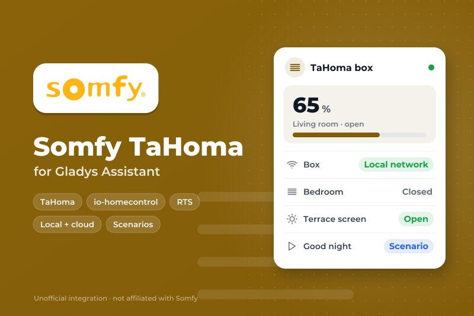
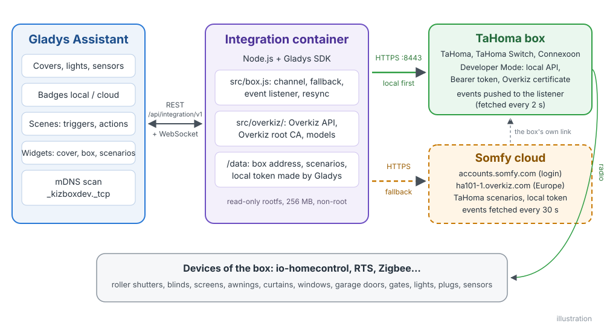
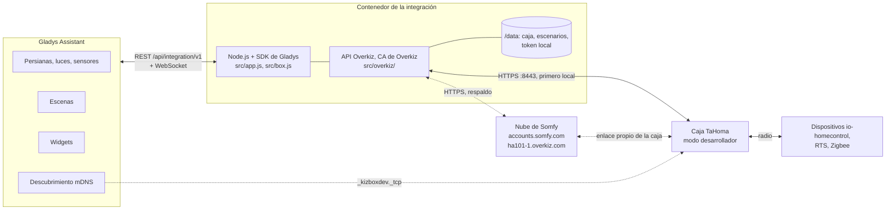
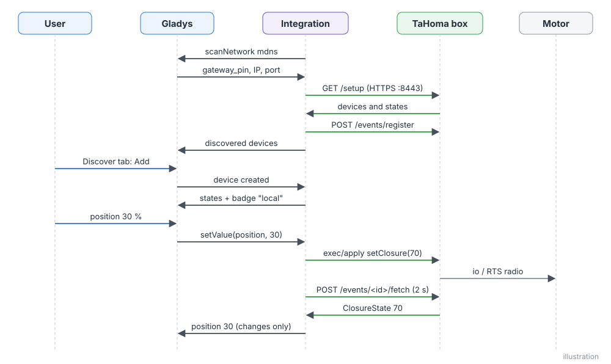
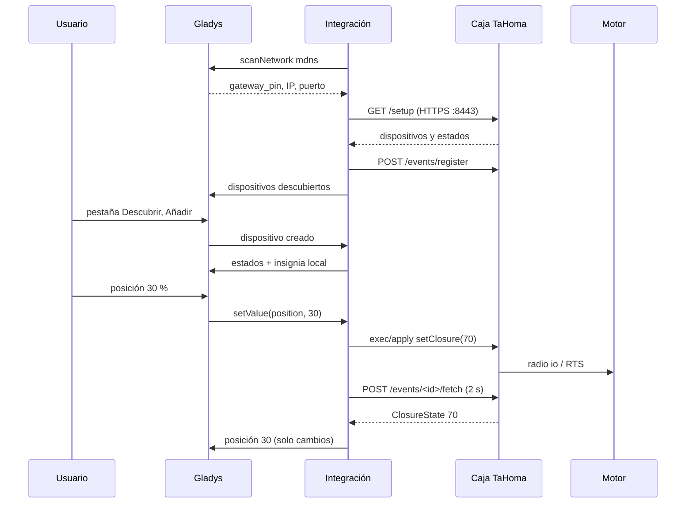
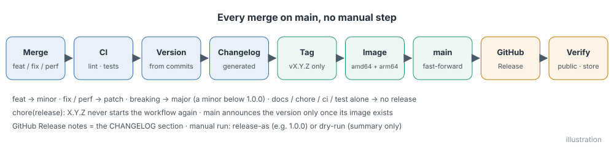

# Somfy TaHoma para Gladys Assistant

[English](README.md) | [Français](README.fr.md) | [Deutsch](README.de.md) | **Español**

[](LICENSE)
[](https://github.com/William-De71/gladys-somfy-tahoma/releases)
[](https://github.com/William-De71/gladys-somfy-tahoma/actions/workflows/release.yml)
[](https://gladysassistant.com)



Su caja Somfy TaHoma (TaHoma, TaHoma Switch, Connexoon) en Gladys Assistant: persianas, estores, toldos, cortinas, puertas de garaje y portones, luces, enchufes y sensores, en la red local gracias al modo desarrollador o a través de la nube de Somfy, primero en local con la nube como respaldo. No oficial, sin relación con Somfy.

## Funciones

- **Dos canales**: la API local del modo desarrollador de Somfy (HTTPS en el puerto 8443, certificado verificado con la autoridad raíz de Overkiz) y la nube de Somfy (cuenta TaHoma). El interruptor «Preferir la conexión local» de Gladys elige el primero; el otro sirve de respaldo, indicado por un punto naranja en la insignia de transporte, y el preferido se vuelve a probar cada 5 minutos.
- **Modo local en un clic**: a través de la cuenta TaHoma, el botón de configuración enciende el modo desarrollador de la caja y crea un token local llamado «Gladys Assistant». También se puede pegar un token creado en la aplicación TaHoma.
- **Descubrimiento**: la caja se encuentra con la búsqueda mDNS de Gladys (`_kizboxdev._tcp`, PIN en el registro TXT), se puede escribir una dirección; cada dispositivo de la caja se ofrece en la pestaña Descubrir.
- **Persianas** (estado, posición, lamas, «My»), **luces** (encendido / apagado, intensidad), **enchufes**, **sensores** (temperatura, luminosidad, humedad, apertura, movimiento, humo, fuga de agua, batería, CO2, potencia, índice de energía).
- **Estados enviados por la caja**: el receptor de eventos de la caja, consultado cada 2 s en la red local, cada 30 s en la nube (2 s durante un minuto tras una orden); Gladys no consulta nada en bucle.
- **Tres widgets**: una persiana con sus botones y su posición «My», la caja y sus persianas de un vistazo, los escenarios TaHoma con botones para ejecutarlos.
- **Tres disparadores de escena** (una orden ha fallado, un dispositivo deja de responder o vuelve a hacerlo, la caja se pierde o vuelve) y **dos acciones de escena** (ejecutar un escenario TaHoma, repetido en local en modo local; enviar una orden como «My»).
- Inglés, francés, alemán y español.

La tienda ya ofrece una integración **Overkiz** ([cicoub13/gladys-overkiz](https://github.com/cicoub13/gladys-overkiz)), solo en la nube, que gestiona también las cuentas Atlantic Cozytouch, Flexom, Rexel e Hitachi. Esta está dedicada a las cajas Somfy y añade el modo local.

## Funcionamiento





Los dos canales hablan la misma API «enduser» de Overkiz. La integración lee `GET /setup` (dispositivos y estados), registra un receptor de eventos (`POST /events/register`) y lo consulta (`POST /events/<id>/fetch`); una orden es una ejecución (`POST /exec/apply`). La nube añade los escenarios TaHoma (`GET /actionGroups`, `POST /exec/<id>`) y los tokens locales (`config/<pin>/local/tokens`). La conexión a la nube usa el inicio de sesión con contraseña de la aplicación TaHoma en `accounts.somfy.com` y después un token Bearer renovado con su token de actualización: Somfy bloquea las cuentas que se conectan demasiado a menudo. Los errores se clasifican como lo hace [pyoverkiz](https://github.com/iMicknl/python-overkiz-api).





### Dispositivos y funciones

| Dispositivo TaHoma (uiClass)                                                                       | Dispositivo Gladys | Funciones                                                                                                                              |
| -------------------------------------------------------------------------------------------------- | ------------------ | -------------------------------------------------------------------------------------------------------------------------------------- |
| RollerShutter, Shutter, SwingingShutter, Screen, ExteriorScreen, Window, Pergola, GarageDoor, Gate | `shutter`          | `state` (−1 cerrar, 0 parar, 1 abrir), `position` (si se indica)                                                                       |
| VenetianBlind, ExteriorVenetianBlind, AdjustableSlatsRollerShutter, pérgola con lamas              | `shutter`          | `state`, `position`, `tilt`                                                                                                            |
| Awning (toldo)                                                                                     | `shutter`          | `state`, `position` (despliegue)                                                                                                       |
| Curtain (cortina)                                                                                  | `curtain`          | `state`, `position`                                                                                                                    |
| motor de un solo botón (`cycle`)                                                                   | `shutter`          | solo `state`                                                                                                                           |
| motor RTS                                                                                          | `shutter`          | `state`, sin respuesta de estado                                                                                                       |
| Light (luz)                                                                                        | `light`            | `light` (`binary`), `brightness` si es regulable                                                                                       |
| OnOff, SwimmingPool                                                                                | `switch`           | `switch` (`binary`)                                                                                                                    |
| cualquier dispositivo con estos estados                                                            | sensores           | `temperature`, `luminance`, `humidity`, `contact`, `motion`, `smoke`, `leak`, `battery`, `battery_low`, `co2`, `power`, `energy` (kWh) |

Las posiciones van de 0 % cerrado a 100 % abierto, como las cuenta Gladys; Overkiz cuenta el cierre (`core:ClosureState`, invertido) o el despliegue de un toldo (`core:DeploymentState`). Los valores reservados 108 («My») y 124 (desconocido) no son posiciones. La elección de órdenes y estados por tipo de persiana sigue la [integración Overkiz de Home Assistant](https://github.com/home-assistant/core/tree/dev/homeassistant/components/overkiz). Identificadores externos: `ext:<selector>:device:<deviceURL con letras, cifras y guiones>` (por ejemplo `io-1234-5678-9012-12184029`), iguales en los dos canales; funciones `…:state`, `…:position`, `…:tilt`, `…:light`, `…:brightness`, `…:switch` y las claves de los sensores.

Baterías: `battery` lee el indicador (`core:BatteryLevelState`) cuando existe; si no, la palabra de `core:BatteryDiscreteLevelState` (persianas Velux solares: good / medium / low / critical) o de `core:BatteryState` (full / normal / medium / low / verylow), convertida en 100 / 75 / 50 / 15 / 5 %; `battery_low` (1 desde low) solo existe para esas palabras. Home Assistant muestra la palabra y gladys-overkiz solo un aviso de batería baja: los porcentajes son una estimación (la app de Somfy muestra 100 % para «good»). Una palabra declarada pero nunca rellenada (Velux con cable) no da batería.

## Transporte

`transports: ["local", "cloud"]`: el catálogo muestra las dos insignias y Gladys muestra el interruptor **Preferir la conexión local** (`GLADYS_PREFER_LOCAL`, activado por defecto). Cada dispositivo publica el canal en uso: **local**, **nube**, o **inaccesible** cuando ninguno responde. Cuando el canal preferido falla y se usa el otro, la insignia lleva un **punto naranja** y el motivo (token rechazado, caja no encontrada, certificado rechazado, contraseña incorrecta, límite de solicitudes…). En modo local nada sale de la red local, salvo la lectura de los escenarios TaHoma cada hora si hay una cuenta; en modo nube, órdenes y estados pasan por Somfy.

## Widgets


- **Persiana TaHoma** (`cover`, ajuste: una persiana): indicador en directo de la posición, estado, lamas, posición «My» y los botones **Abrir**, **Parar**, **My** (la posición favorita guardada en el motor) y **Cerrar**; un motor de un solo botón muestra un solo botón.
- **Caja TaHoma** (`overview`): las persianas añadidas a Gladys con su estado y posición, el canal en uso, el firmware, los dispositivos que no responden y un botón **Leer estados**. Con más de ocho persianas se muestran siete (primero las que se mueven, están abiertas o no responden) y una última tarjeta «+ N persiana(s) más» nombra las demás. Ajuste `names`: las persianas mostradas, nombres separados por comas, en ese orden.
- **Escenarios TaHoma** (`scenarios`, ajuste: nombres separados por comas): los escenarios TaHoma y botones para ejecutar hasta cuatro.

## Disparadores y acciones de escena

Disparadores:

- `command_failed` — **Una orden TaHoma ha fallado**, desde Gladys, la aplicación TaHoma o un escenario TaHoma (nunca por una acción de escena de Gladys). Filtro: dispositivo. Variables: `device_name`, `failure_type` (código Overkiz, por ejemplo `WHILEEXEC_BLOCKED_BY_HAZARD`), `label`.
- `device_availability_changed` — **Un dispositivo TaHoma deja de responder o vuelve a hacerlo**. Filtros: dispositivo, `state` (`available`, `unavailable`). Variable: `device_name`.
- `box_connection_changed` — **La caja TaHoma se pierde o vuelve** (ningún canal durante un minuto, o Somfy la indica desconectada). Filtro: `state` (`offline`, `online`). Variables: `transport` (`local`, `cloud`, `none`), `pin`.

Acciones:

- `run_scenario` — **Ejecutar un escenario TaHoma** por su nombre (o su identificador). En la nube: `exec/<id>`; en la API local: sus acciones repetidas con `exec/apply`. Salidas: `exec_id`, `scenario`, `transport`.
- `send_command` — **Enviar una orden TaHoma** a un dispositivo: `open`, `close`, `stop`, `my`, `identify`. Salidas: `exec_id`, `transport`.

Ejemplos:

- **La caja TaHoma se pierde o vuelve**, `offline` → enviar un mensaje «La caja TaHoma ya no responde».
- **Una orden TaHoma ha fallado**, persiana del salón → avisar con `{{triggerEvent.data.failure_type}}`.
- Al anochecer → **Ejecutar un escenario TaHoma** «Buenas noches».

## Requisitos

- Gladys Assistant **5.3.0 o posterior** (interruptor «Preferir la conexión local», palabras clave del catálogo, widgets y escenas de las integraciones; las instancias más antiguas no pueden instalar la integración).
- Una caja TaHoma, TaHoma Switch, TaHoma Beecon o Connexoon. Modo local: una caja compatible con el modo desarrollador (no la primera TaHoma cuadrada, no el kit de conectividad) en la misma red que Gladys. Nube y escenarios: la cuenta de la aplicación TaHoma.

## Instalación

- **Desde la tienda**: Integraciones → buscar «Somfy TaHoma» → Instalar. Acepte el descubrimiento de red (mDNS) en la pantalla de instalación.
- **Desde la URL del repositorio**: Integraciones → Instalar una integración → pegar `https://github.com/William-De71/gladys-somfy-tahoma`.
- **Modo desarrollador**: Integraciones → Instalar una integración → Modo desarrollador, con el manifiesto de un build (el resumen del workflow «Build and publish image» lo muestra).

## Configuración

| Campo         | Tipo   | Por defecto | Significado                                                                |
| ------------- | ------ | ----------- | -------------------------------------------------------------------------- |
| `region`      | select | `europe`    | región de la cuenta: `europe`, `north_america`, `oceania`                  |
| `username`    | string | vacío       | correo de la aplicación TaHoma                                             |
| `password`    | secret | vacío       | contraseña de la aplicación TaHoma                                         |
| `local_token` | secret | vacío       | token del modo desarrollador (innecesario con el botón de abajo)           |
| `local_host`  | string | vacío       | dirección IP de la caja (`IP` o `IP:puerto`), solo si mDNS no la encuentra |
| `gateway_pin` | string | vacío       | PIN de la caja, solo para una cuenta con varias cajas                      |
| `language`    | select | `en`        | idioma de los nombres de las funciones y de los errores de escena          |

Botones de la página de configuración: **Probar la conexión** (se vuelve a conectar e indica qué canal responde, por qué el otro no, cuántos dispositivos y escenarios) y **Activar el modo local** (modo desarrollador encendido y token «Gladys Assistant», a través de la cuenta).

## Uso

1. Instale la integración, escriba la cuenta TaHoma y guarde.
2. Pulse **Activar el modo local** (o pegue un token del modo desarrollador).
3. Añada los dispositivos desde la pestaña **Descubrir**, colóquelos en habitaciones, añada los widgets y cree sus escenas.

La documentación de usuario está en [docs/es.md](docs/es.md) ([en](docs/en.md), [fr](docs/fr.md), [de](docs/de.md)).

## Límites

- **Nunca probada con una caja real**: todo se prueba contra una nube de Somfy y una caja simuladas (servidor HTTPS local real) que responden como las reales, según las respuestas registradas por pyoverkiz y la documentación de Somfy. Se agradecen los comentarios.
- Una caja por integración (el PIN elige en una cuenta con varias).
- Aún no gestionados: la calefacción (termostatos, válvulas, bombas de calor, calentadores de agua), las alarmas, las cámaras, Hue y Sonos detrás de la caja, el color de las luces.
- Los motores RTS son unidireccionales: no vuelve ni posición ni estado.
- Los escenarios TaHoma necesitan la cuenta: la API local no tiene. Repetido en local, un escenario ejecuta sus órdenes, no sus retrasos ni sus condiciones.
- La API local depende del modo desarrollador: un reinicio de fábrica o algunas actualizaciones de firmware pueden desactivarlo.

## Desarrollo local

```bash
npm install
GLADYS_HOST_API_URL=http://localhost:1443 \
  GLADYS_INTEGRATION_TOKEN=… GLADYS_INTEGRATION_SELECTOR=… \
  TAHOMA_DATA_DIR=./data DEBUG=gladys-integration-sdk node index.js
```

| Variable                                                                         | Por defecto        | Uso                                                         |
| -------------------------------------------------------------------------------- | ------------------ | ----------------------------------------------------------- |
| `GLADYS_HOST_API_URL`, `GLADYS_INTEGRATION_TOKEN`, `GLADYS_INTEGRATION_SELECTOR` | fijadas por Gladys | conexión a la API de host de Gladys                         |
| `TAHOMA_DATA_DIR`                                                                | `/data`            | carpeta de `box.json`, `scenarios.json`, `local-token.json` |
| `DEBUG`                                                                          | sin definir        | `gladys-integration-sdk` para los registros del SDK         |

| Script                            | Qué hace                                              |
| --------------------------------- | ----------------------------------------------------- |
| `npm test`                        | las pruebas (`node --test`), nunca salen de 127.0.0.1 |
| `npm run lint`                    | ESLint                                                |
| `npm run format` / `format:check` | Prettier                                              |
| `docs/illustrations/render.sh`    | regenera las ilustraciones de los widgets             |
| `scripts/build-cover.sh`          | regenera `cover.jpg` desde `docs/assets/cover.svg`    |

## Pruebas

`npm test` ejecuta toda la integración contra el Gladys simulado del SDK, una nube de Somfy simulada (token, API de la nube) y una caja TaHoma simulada (HTTPS con una autoridad de prueba), que responden con las instalaciones, escenarios y mensajes de error registrados por pyoverkiz. Cubierto: el descubrimiento desde una instalación real (17 dispositivos), estados en cadenas o números, las posiciones y sus valores reservados, cada orden, el canal local encontrado por mDNS o escrito, el respaldo en la nube (token rechazado, certificado falso, certificado de otra caja) y la vuelta al local, la preferencia por la nube, una caja perdida, un receptor caducado, el modo local activado desde la cuenta, los escenarios en ambos canales, los tres disparadores, las dos acciones, los tres widgets validados con `validateWidgetContent`, los reinicios. Los identificadores se comparan con una referencia (son permanentes), el manifiesto con el código, así como las traducciones y el script de publicación. La CI también construye la imagen y la arranca como Gladys (solo lectura, 256 MB, sin red).

## Proceso de publicación

Cada fusión en `main` publica una versión cuando sus commits lo justifican, sin ningún paso manual:

```mermaid
flowchart LR
  A[fusión en main] --> B[CI: Prettier, ESLint,<br/>pruebas, build Docker]
  B --> C[siguiente versión según<br/>los Conventional Commits]
  C --> D[sección de CHANGELOG.md]
  D --> E[commit chore release<br/>+ tag vX.Y.Z]
  E --> F[imagen :X.Y.Z + :latest<br/>amd64 + arm64]
  F --> G[main avanza al<br/>commit de publicación]
  G --> H[GitHub Release]
  H --> I[verificación: pull anónimo,<br/>validador de la tienda, topic]
```





- `feat` → menor, `fix` / `perf` → parche, `!` o `BREAKING CHANGE:` → mayor (una menor mientras la versión es inferior a 1.0.0). `docs`, `chore`, `ci`, `test`, `style`, `refactor`, `build` solos no publican nada.
- El título de la pull request se convierte en el commit squash, es decir, en la línea del changelog: escríbalo en inglés, para el usuario (`feat(widgets): …`). `pr-title.yml` lo comprueba. No edite nunca `CHANGELOG.md` a mano.
- La imagen existe antes de que `main` anuncie su versión (la tienda indexa `main`).
- La 1.0.0 es una decisión manual: Actions → Release → Run workflow, `release-as: 1.0.0`. `dry-run` muestra la versión y el changelog sin publicar nada.
- **`main` protegida**: la publicación empuja un commit a `main`. Con una protección de rama o un ruleset que exija pull requests o status checks, permita a GitHub Actions saltarlo (o use una GitHub App); si no, la publicación se detiene tras la imagen.
- Tras la primera publicación, haga público el paquete si hace falta: Package settings → Change visibility → Public.

## Solución de problemas

- **Probar la conexión** indica qué canal responde y por qué el otro no.
- **«Somfy rechazó el correo o la contraseña»**: compruébelos en la aplicación TaHoma; tras muchos fallos, Somfy bloquea las conexiones un tiempo.
- **«Caja no encontrada en la red local»**: escriba su dirección IP y compruebe que el modo desarrollador sigue activo.
- **«La caja rechazó el token local»**: pulse de nuevo **Activar el modo local** o pegue un token nuevo.
- **«Gladys rechazó la búsqueda en la red»**: reinstale la integración aceptando su descubrimiento de red, o escriba la dirección de la caja.
- Registros: la pestaña Logs de la integración; `DEBUG=gladys-integration-sdk` para el detalle del SDK.

## Contribuir

Las issues y pull requests son bienvenidas. Ejecute `npm run format:check`, `npm run lint` y `npm test`, escriba el título de la pull request como Conventional Commit y vuelva a lanzar `docs/illustrations/render.sh` tras cualquier cambio en el contenido de un widget. Una novedad no debe cambiar los identificadores existentes (`test/fixtures/discovery.baseline.json`). Cuando una caja real se comporta de otro modo, corrija primero la simulada de `test/helpers/` y después el código.

## Seguridad

Consulte [SECURITY.md](SECURITY.md). La contraseña de la cuenta y el token local son secretos de la configuración de Gladys, nunca registrados; los tokens de la nube permanecen en memoria. `/data` guarda el PIN y la dirección de la caja, los escenarios TaHoma y el token local creado por el botón. La API local se alcanza por HTTPS, con el certificado verificado con la autoridad raíz de Overkiz.

## Licencia

[Licencia Apache 2.0](LICENSE), véase también [NOTICE](NOTICE). El cliente Overkiz se escribió para este proyecto a partir de la documentación del modo desarrollador de Somfy, [pyoverkiz](https://github.com/iMicknl/python-overkiz-api) (MIT) y la integración Overkiz de Home Assistant (Apache 2.0). Somfy, TaHoma y Connexoon son marcas de Somfy; este proyecto no está afiliado a Somfy ni a Overkiz, ni cuenta con su aprobación o apoyo.
