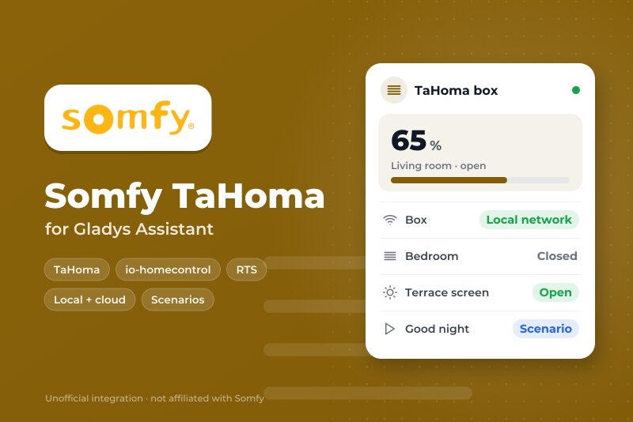
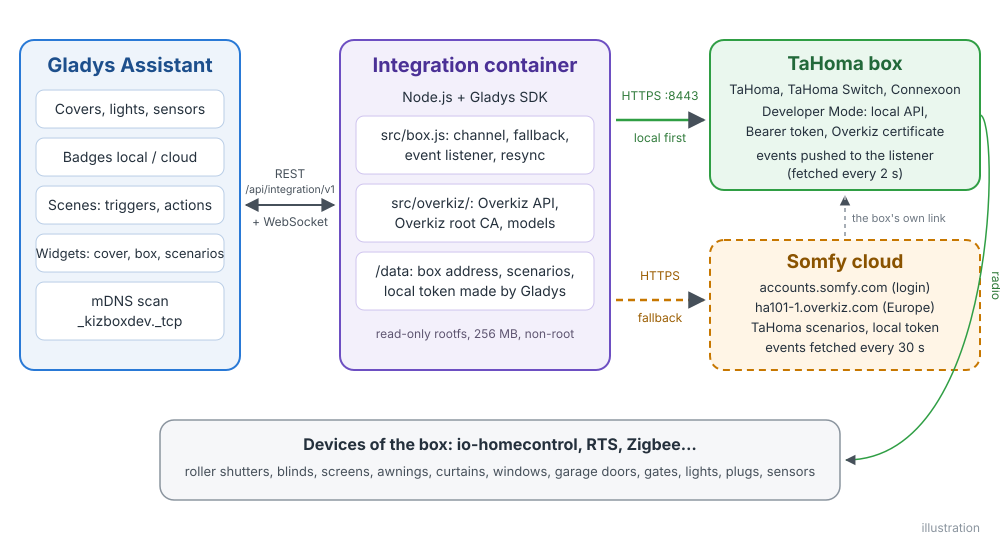
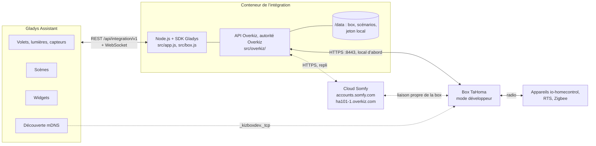
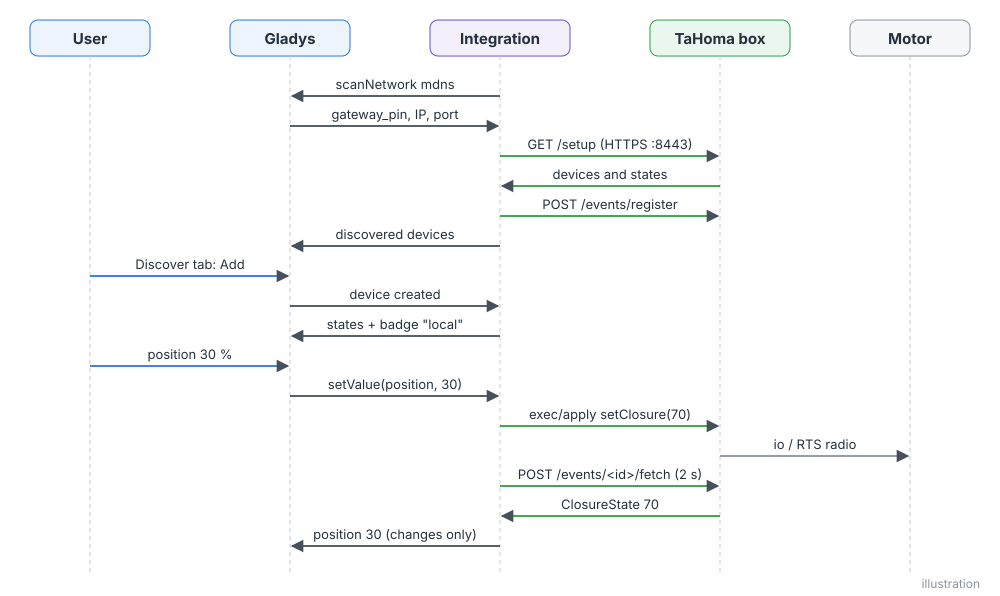
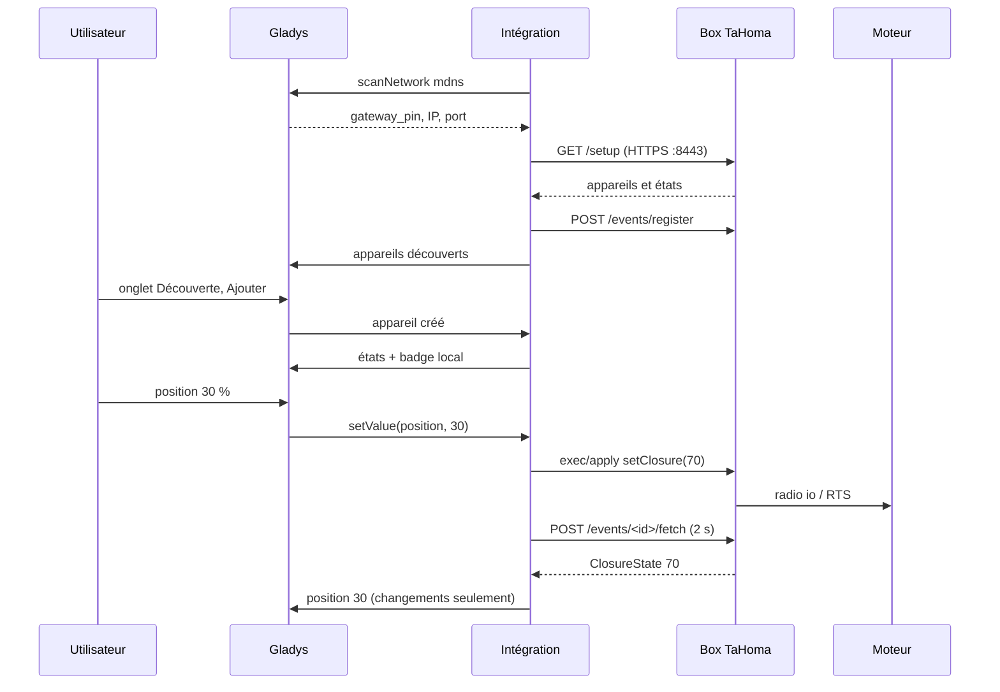
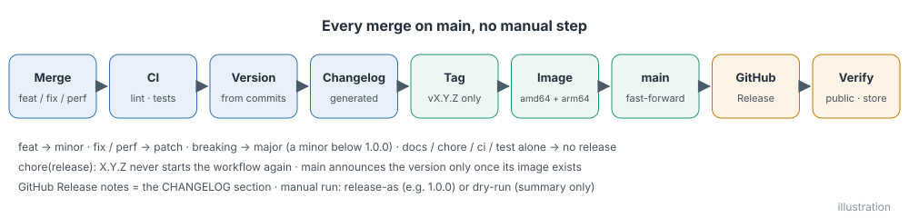

# Somfy TaHoma pour Gladys Assistant

[English](README.md) | **Français** | [Deutsch](README.de.md) | [Español](README.es.md)

[](LICENSE)
[](https://github.com/William-De71/gladys-somfy-tahoma/releases)
[](https://github.com/William-De71/gladys-somfy-tahoma/actions/workflows/release.yml)
[](https://gladysassistant.com)



Votre box Somfy TaHoma (TaHoma, TaHoma Switch, Connexoon) dans Gladys Assistant : volets roulants, stores, stores bannes, rideaux, portes de garage et portails, lumières, prises et capteurs, sur le réseau local grâce au mode développeur ou via le cloud Somfy, en local d’abord avec le cloud en repli. Intégration non officielle, sans lien avec Somfy.

## Fonctionnalités

- **Deux canaux** : l’API locale du mode développeur Somfy (HTTPS sur le port 8443, certificat vérifié avec l’autorité racine Overkiz) et le cloud Somfy (compte TaHoma). L’interrupteur « Préférer la connexion locale » de Gladys choisit le premier ; l’autre sert de repli, signalé par un point orange sur le badge de transport, et le canal préféré est réessayé toutes les 5 minutes.
- **Mode local en un clic** : via le compte TaHoma, le bouton de configuration allume le mode développeur de la box et crée un jeton local nommé « Gladys Assistant ». Un jeton créé dans l’application TaHoma peut aussi être collé.
- **Découverte** : la box est trouvée par la recherche mDNS de Gladys (`_kizboxdev._tcp`, PIN dans l’enregistrement TXT), une adresse peut être saisie ; chaque appareil connu de la box est proposé dans l’onglet Découverte.
- **Volets** (état, position, lames, « My »), **lumières** (marche / arrêt, intensité), **prises**, **capteurs** (température, luminosité, humidité, ouverture, mouvement, fumée, fuite d’eau, batterie, CO2, puissance, index d’énergie).
- **États poussés** : l’écouteur d’événements de la box, relevé toutes les 2 s sur le réseau local, toutes les 30 s sur le cloud (2 s pendant une minute après une commande) ; Gladys n’interroge rien en boucle.
- **Trois widgets** : un volet avec ses boutons et sa position « My », la box et ses volets d’un coup d’œil, les scénarios TaHoma avec des boutons pour les lancer.
- **Trois déclencheurs de scène** (une commande a échoué, un appareil ne répond plus ou à nouveau, la box est perdue ou revenue) et **deux actions de scène** (lancer un scénario TaHoma, rejoué en local en mode local ; envoyer une commande comme « My »).
- Anglais, français, allemand et espagnol.

Le store propose déjà une intégration **Overkiz** ([cicoub13/gladys-overkiz](https://github.com/cicoub13/gladys-overkiz)), en cloud seulement, qui gère aussi les comptes Atlantic Cozytouch, Flexom, Rexel et Hitachi. Celle-ci est dédiée aux box Somfy et ajoute le mode local.

## Fonctionnement





Les deux canaux parlent la même API « enduser » d’Overkiz. L’intégration lit `GET /setup` (appareils et états), enregistre un écouteur d’événements (`POST /events/register`) et le relève (`POST /events/<id>/fetch`) ; une commande est une exécution (`POST /exec/apply`). Le cloud ajoute les scénarios TaHoma (`GET /actionGroups`, `POST /exec/<id>`) et les jetons locaux (`config/<pin>/local/tokens`). La connexion au cloud utilise l’authentification par mot de passe de l’application TaHoma sur `accounts.somfy.com`, puis un jeton Bearer renouvelé par son jeton de rafraîchissement : Somfy bannit les comptes qui se connectent trop souvent. Les erreurs sont classées comme le fait [pyoverkiz](https://github.com/iMicknl/python-overkiz-api).





### Appareils et fonctionnalités

| Appareil TaHoma (uiClass)                                                                          | Appareil Gladys | Fonctionnalités                                                                                                         |
| -------------------------------------------------------------------------------------------------- | --------------- | ----------------------------------------------------------------------------------------------------------------------- |
| RollerShutter, Shutter, SwingingShutter, Screen, ExteriorScreen, Window, Pergola, GarageDoor, Gate | `shutter`       | `state` (−1 fermer, 0 stop, 1 ouvrir), `position` (si fournie)                                                          |
| VenetianBlind, ExteriorVenetianBlind, AdjustableSlatsRollerShutter, pergola à lames                | `shutter`       | `state`, `position`, `tilt`                                                                                             |
| Awning (store banne)                                                                               | `shutter`       | `state`, `position` (déploiement)                                                                                       |
| Curtain (rideau)                                                                                   | `curtain`       | `state`, `position`                                                                                                     |
| ouvrant à un seul bouton (`cycle`)                                                                 | `shutter`       | `state` seulement                                                                                                       |
| moteur RTS                                                                                         | `shutter`       | `state`, sans retour d’état                                                                                             |
| Light (lumière)                                                                                    | `light`         | `light` (`binary`), `brightness` si variable                                                                            |
| OnOff, SwimmingPool                                                                                | `switch`        | `switch` (`binary`)                                                                                                     |
| tout appareil ayant ces états                                                                      | capteurs        | `temperature`, `luminance`, `humidity`, `contact`, `motion`, `smoke`, `leak`, `battery`, `co2`, `power`, `energy` (kWh) |

Les positions vont de 0 % fermé à 100 % ouvert, comme les compte Gladys ; Overkiz compte la fermeture (`core:ClosureState`, inversée) ou le déploiement d’un store banne (`core:DeploymentState`). Les valeurs réservées 108 (« My ») et 124 (inconnue) ne sont pas des positions. Le choix des commandes et des états par type de volet suit l’[intégration Overkiz de Home Assistant](https://github.com/home-assistant/core/tree/dev/homeassistant/components/overkiz). Identifiants externes : `ext:<selector>:device:<deviceURL en lettres, chiffres et tirets>` (par exemple `io-1234-5678-9012-12184029`), identiques sur les deux canaux ; fonctionnalités `…:state`, `…:position`, `…:tilt`, `…:light`, `…:brightness`, `…:switch` et les clés des capteurs.

## Transport

`transports: ["local", "cloud"]` : le catalogue affiche les deux badges et Gladys affiche l’interrupteur **Préférer la connexion locale** (`GLADYS_PREFER_LOCAL`, activé par défaut). Chaque appareil publie le canal utilisé : **local**, **cloud**, ou **injoignable** quand aucun ne répond. Quand le canal préféré échoue et que l’autre est utilisé, le badge porte un **point orange** et la raison (jeton refusé, box introuvable, certificat refusé, mot de passe erroné, limite de requêtes…). En mode local rien ne sort du réseau local, sauf la lecture horaire des scénarios TaHoma si un compte est saisi ; en mode cloud, commandes et états passent par Somfy.

## Widgets


- **Volet TaHoma** (`cover`, réglage : un volet) : jauge en direct de la position, état, lames, position « My », et les boutons **Ouvrir**, **Stop**, **My** (la position favorite enregistrée dans le moteur) et **Fermer** ; un ouvrant à un seul bouton n’en affiche qu’un.
- **Box TaHoma** (`overview`) : les volets ajoutés à Gladys (huit au plus) avec leur état et leur position, le canal utilisé, le micrologiciel, les appareils muets, et un bouton **Relire les états**.
- **Scénarios TaHoma** (`scenarios`, réglage : noms séparés par des virgules) : les scénarios TaHoma et des boutons pour en lancer jusqu’à quatre.

## Déclencheurs et actions de scène

Déclencheurs :

- `command_failed` — **Une commande TaHoma a échoué**, depuis Gladys, l’application TaHoma ou un scénario TaHoma (jamais pour une action de scène de Gladys). Filtre : appareil. Variables : `device_name`, `failure_type` (code Overkiz, par exemple `WHILEEXEC_BLOCKED_BY_HAZARD`), `label`.
- `device_availability_changed` — **Un appareil TaHoma ne répond plus ou répond à nouveau**. Filtres : appareil, `state` (`available`, `unavailable`). Variable : `device_name`.
- `box_connection_changed` — **La box TaHoma est perdue ou revenue** (aucun canal pendant une minute, ou Somfy la dit hors ligne). Filtre : `state` (`offline`, `online`). Variables : `transport` (`local`, `cloud`, `none`), `pin`.

Actions :

- `run_scenario` — **Lancer un scénario TaHoma** par son nom (ou son identifiant). Sur le cloud : `exec/<id>` ; sur l’API locale : ses actions rejouées avec `exec/apply`. Sorties : `exec_id`, `scenario`, `transport`.
- `send_command` — **Envoyer une commande TaHoma** à un appareil : `open`, `close`, `stop`, `my`, `identify`. Sorties : `exec_id`, `transport`.

Exemples :

- **La box TaHoma est perdue ou revenue**, `offline` → envoyer un message « La box TaHoma ne répond plus ».
- **Une commande TaHoma a échoué**, volet du salon → prévenir avec `{{triggerEvent.data.failure_type}}`.
- Au coucher du soleil → **Lancer un scénario TaHoma** « Bonne nuit ».

## Prérequis

- Gladys Assistant **5.3.0 ou plus récent** (interrupteur « Préférer la connexion locale », mots-clés du catalogue, widgets et scènes des intégrations ; les instances plus anciennes ne peuvent pas installer l’intégration).
- Une box TaHoma, TaHoma Switch, TaHoma Beecon ou Connexoon. Mode local : une box compatible avec le mode développeur (pas la première TaHoma carrée, pas le kit de connectivité) sur le même réseau que Gladys. Cloud et scénarios : le compte de l’application TaHoma.

## Installation

- **Depuis le store** : Intégrations → chercher « Somfy TaHoma » → Installer. Acceptez la découverte réseau (mDNS) à l’écran d’installation.
- **Depuis l’URL du dépôt** : Intégrations → Installer une intégration → coller `https://github.com/William-De71/gladys-somfy-tahoma`.
- **Mode développeur** : Intégrations → Installer une intégration → Mode développeur, avec le manifeste d’un build (le résumé du workflow « Build and publish image » l’affiche).

## Configuration

| Champ         | Type   | Défaut   | Rôle                                                                         |
| ------------- | ------ | -------- | ---------------------------------------------------------------------------- |
| `region`      | select | `europe` | région du compte : `europe`, `north_america`, `oceania`                      |
| `username`    | string | vide     | e-mail de l’application TaHoma                                               |
| `password`    | secret | vide     | mot de passe de l’application TaHoma                                         |
| `local_token` | secret | vide     | jeton du mode développeur (inutile avec le bouton ci-dessous)                |
| `local_host`  | string | vide     | adresse IP de la box (`IP` ou `IP:port`), seulement si mDNS ne la trouve pas |
| `gateway_pin` | string | vide     | PIN de la box, seulement pour un compte avec plusieurs box                   |
| `language`    | select | `en`     | langue des noms de fonctionnalités et des erreurs de scène                   |

Boutons de la page de configuration : **Tester la connexion** (se reconnecte et indique quel canal répond, pourquoi l’autre ne répond pas, combien d’appareils et de scénarios) et **Activer le mode local** (mode développeur allumé et jeton « Gladys Assistant », via le compte).

## Utilisation

1. Installez l’intégration, saisissez le compte TaHoma et enregistrez.
2. Appuyez sur **Activer le mode local** (ou collez un jeton du mode développeur).
3. Ajoutez les appareils depuis l’onglet **Découverte**, rangez-les dans des pièces, ajoutez les widgets, créez vos scènes.

La documentation utilisateur est dans [docs/fr.md](docs/fr.md) ([en](docs/en.md), [de](docs/de.md), [es](docs/es.md)).

## Limites

- **Jamais testée sur une vraie box** : tout est testé contre un faux cloud Somfy et une fausse box (vrai serveur HTTPS local) qui répondent comme les vrais, d’après les réponses enregistrées par pyoverkiz et la documentation de Somfy. Les retours sont bienvenus.
- Une box par intégration (le PIN choisit sur un compte qui en a plusieurs).
- Pas encore gérés : le chauffage (thermostats, vannes, pompes à chaleur, chauffe-eau), les alarmes, les caméras, Hue et Sonos derrière la box, la couleur des lumières.
- Les moteurs RTS sont à sens unique : aucune position ni aucun état ne revient.
- Les scénarios TaHoma nécessitent le compte : l’API locale n’en a pas. Rejoué en local, un scénario exécute ses commandes, pas ses délais ni ses conditions.
- L’API locale dépend du mode développeur : une remise à zéro ou certaines mises à jour du micrologiciel peuvent le couper.

## Développement local

```bash
npm install
GLADYS_HOST_API_URL=http://localhost:1443 \
  GLADYS_INTEGRATION_TOKEN=… GLADYS_INTEGRATION_SELECTOR=… \
  TAHOMA_DATA_DIR=./data DEBUG=gladys-integration-sdk node index.js
```

| Variable                                                                         | Défaut            | Usage                                                       |
| -------------------------------------------------------------------------------- | ----------------- | ----------------------------------------------------------- |
| `GLADYS_HOST_API_URL`, `GLADYS_INTEGRATION_TOKEN`, `GLADYS_INTEGRATION_SELECTOR` | fixées par Gladys | connexion à l’API hôte de Gladys                            |
| `TAHOMA_DATA_DIR`                                                                | `/data`           | dossier de `box.json`, `scenarios.json`, `local-token.json` |
| `DEBUG`                                                                          | non définie       | `gladys-integration-sdk` pour les journaux du SDK           |

| Script                            | Rôle                                                     |
| --------------------------------- | -------------------------------------------------------- |
| `npm test`                        | les tests (`node --test`), sans jamais quitter 127.0.0.1 |
| `npm run lint`                    | ESLint                                                   |
| `npm run format` / `format:check` | Prettier                                                 |
| `docs/illustrations/render.sh`    | régénère les illustrations des widgets                   |
| `scripts/build-cover.sh`          | régénère `cover.jpg` depuis `docs/assets/cover.svg`      |

## Tests

`npm test` fait tourner toute l’intégration contre le faux Gladys du SDK, un faux cloud Somfy (jeton, API cloud) et une fausse box TaHoma (HTTPS avec une autorité de test), qui répondent avec les installations, scénarios et corps d’erreur enregistrés par pyoverkiz. Couvert : la découverte depuis une vraie installation (17 appareils), les états en chaînes ou en nombres, les positions et leurs valeurs réservées, chaque commande, le canal local trouvé par mDNS ou saisi, le repli sur le cloud (jeton refusé, faux certificat, certificat d’une autre box) et le retour au local, la préférence pour le cloud, une box perdue, un écouteur expiré, le mode local activé depuis le compte, les scénarios sur les deux canaux, les trois déclencheurs, les deux actions, les trois widgets validés par `validateWidgetContent`, les redémarrages. Les identifiants sont comparés à une référence (ils sont éternels), le manifeste au code, ainsi que les traductions et le script de release. La CI construit aussi l’image et la démarre comme Gladys (lecture seule, 256 Mo, sans réseau).

## Processus de release

Chaque fusion sur `main` publie une version quand ses commits le justifient, sans aucune action manuelle :

```mermaid
flowchart LR
  A[fusion sur main] --> B[CI : Prettier, ESLint,<br/>tests, build Docker]
  B --> C[version suivante d’après<br/>les Conventional Commits]
  C --> D[section du CHANGELOG.md]
  D --> E[commit chore release<br/>+ tag vX.Y.Z]
  E --> F[image :X.Y.Z + :latest<br/>amd64 + arm64]
  F --> G[main avance sur<br/>le commit de release]
  G --> H[GitHub Release]
  H --> I[vérification : pull anonyme,<br/>validateur du store, topic]
```





- `feat` → mineure, `fix` / `perf` → correctif, `!` ou `BREAKING CHANGE:` → majeure (une mineure tant que la version est sous 1.0.0). `docs`, `chore`, `ci`, `test`, `style`, `refactor`, `build` seuls ne publient rien.
- Le titre de la pull request devient le commit squash, donc la ligne du changelog : écrivez-le en anglais, pour l’utilisateur (`feat(widgets): …`). `pr-title.yml` le vérifie. Ne modifiez jamais `CHANGELOG.md` à la main.
- L’image existe avant que `main` n’annonce sa version (le store indexe `main`).
- La 1.0.0 est une décision manuelle : Actions → Release → Run workflow, `release-as: 1.0.0`. `dry-run` affiche la version et le changelog sans rien publier.
- **`main` protégée** : la release pousse un commit sur `main`. Avec une protection de branche ou un ruleset qui exige des pull requests ou des status checks, autorisez GitHub Actions à le contourner (ou utilisez une GitHub App), sinon la release s’arrête après l’image.
- Après la première release, rendez le package public si besoin : Package settings → Change visibility → Public.

## Dépannage

- **Tester la connexion** indique quel canal répond et pourquoi l’autre ne répond pas.
- **« Somfy a refusé l’e-mail ou le mot de passe »** : vérifiez-les dans l’application TaHoma ; après de nombreux échecs, Somfy bloque les connexions un moment.
- **« Box introuvable sur le réseau local »** : saisissez son adresse IP, vérifiez que le mode développeur est toujours actif.
- **« La box a refusé le jeton local »** : appuyez à nouveau sur **Activer le mode local** ou collez un nouveau jeton.
- **« Gladys a refusé la recherche réseau »** : réinstallez l’intégration en acceptant sa découverte réseau, ou saisissez l’adresse de la box.
- Journaux : l’onglet Logs de l’intégration ; `DEBUG=gladys-integration-sdk` pour le détail du SDK.

## Contribuer

Les issues et pull requests sont bienvenues. Lancez `npm run format:check`, `npm run lint` et `npm test`, écrivez le titre de la pull request en Conventional Commit, et relancez `docs/illustrations/render.sh` après toute modification du contenu d’un widget. Une nouveauté ne doit pas changer les identifiants existants (`test/fixtures/discovery.baseline.json`). Quand une vraie box se comporte autrement, corrigez d’abord la fausse box de `test/helpers/`, puis le code.

## Sécurité

Voir [SECURITY.md](SECURITY.md). Le mot de passe du compte et le jeton local sont des secrets de la configuration de Gladys, jamais journalisés ; les jetons du cloud restent en mémoire. `/data` garde le PIN et l’adresse de la box, les scénarios TaHoma et le jeton local créé par le bouton. L’API locale est jointe en HTTPS, le certificat vérifié avec l’autorité racine Overkiz.

## Licence

[Licence Apache 2.0](LICENSE), voir aussi [NOTICE](NOTICE). Le client Overkiz a été écrit pour ce projet d’après la documentation du mode développeur Somfy, [pyoverkiz](https://github.com/iMicknl/python-overkiz-api) (MIT) et l’intégration Overkiz de Home Assistant (Apache 2.0). Somfy, TaHoma et Connexoon sont des marques de Somfy ; ce projet n’est ni affilié à Somfy ou Overkiz, ni approuvé ou soutenu par eux.
