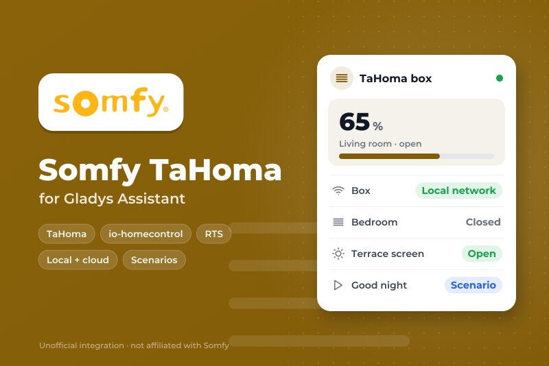
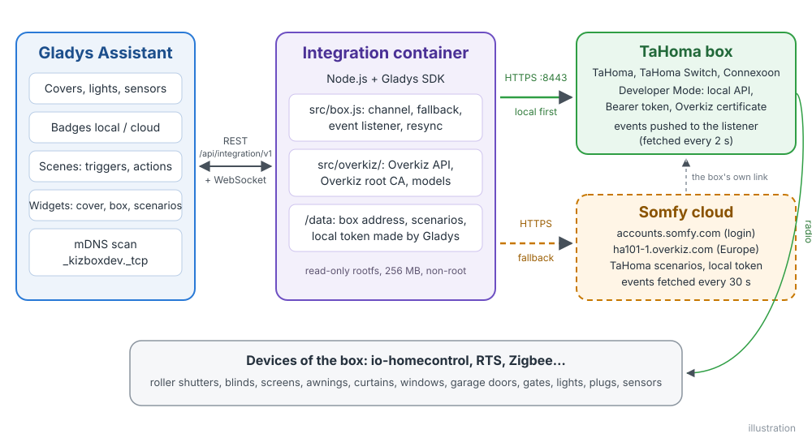
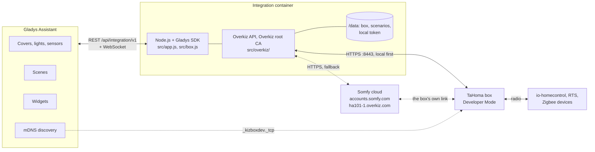
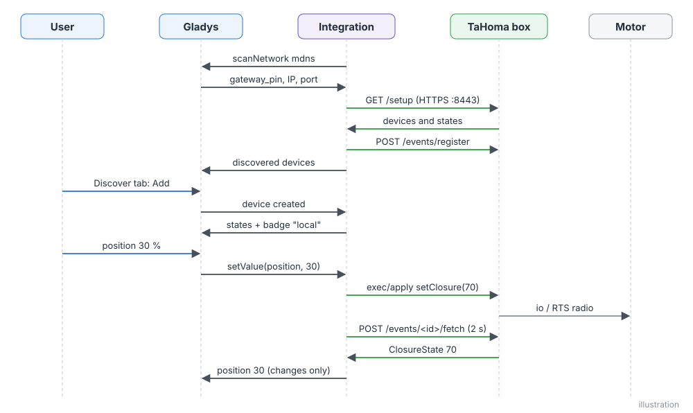
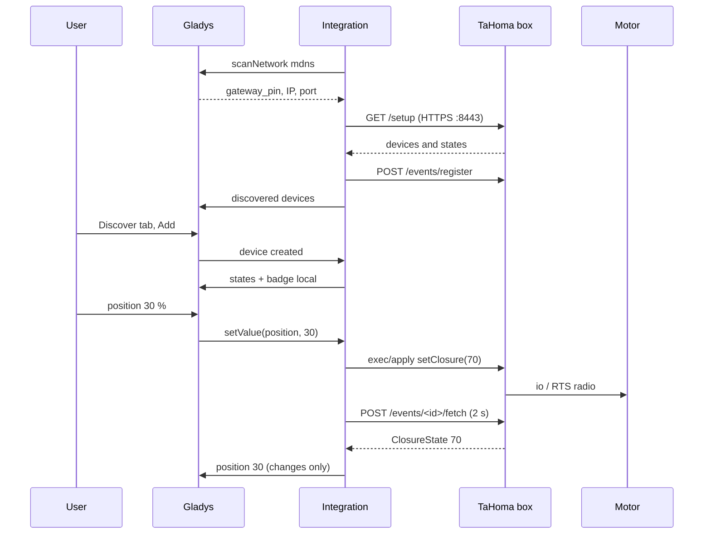
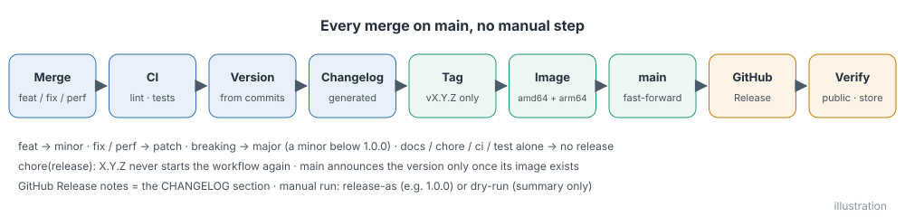

# Somfy TaHoma for Gladys Assistant

**English** | [Français](README.fr.md) | [Deutsch](README.de.md) | [Español](README.es.md)

[](LICENSE)
[](https://github.com/William-De71/gladys-somfy-tahoma/releases)
[](https://github.com/William-De71/gladys-somfy-tahoma/actions/workflows/release.yml)
[](https://gladysassistant.com)



Your Somfy TaHoma box (TaHoma, TaHoma Switch, Connexoon) in Gladys Assistant: roller shutters, blinds, awnings, curtains, garage doors and gates, lights, plugs and sensors, on the local network through the Developer Mode or through the Somfy cloud, local first with the cloud as the fallback. Unofficial, not affiliated with Somfy.

## Features

- **Two channels**: the local API of the Somfy Developer Mode (HTTPS on port 8443, certificate checked against the Overkiz root CA) and the Somfy cloud (TaHoma account). The "Prefer the local connection" switch of Gladys picks the first one; the other is the fallback, shown by an orange dot on the transport badge, and the preferred one is tried again every 5 minutes.
- **One click local mode**: from the TaHoma account, the configuration button turns the Developer Mode of the box on and creates a local token named "Gladys Assistant". A token made in the TaHoma app can also be pasted.
- **Discovery**: the box is found by the mDNS search of Gladys (`_kizboxdev._tcp`, PIN in the TXT record), an address can be typed; every device the box knows is offered in the Discover tab.
- **Covers** (state, position, slats, "My"), **lights** (on / off, intensity), **plugs**, **sensors** (temperature, light, humidity, opening, motion, smoke, water leak, battery, CO2, power, energy index).
- **Pushed states**: the event listener of the box, fetched every 2 s on the local network, every 30 s on the cloud (2 s for a minute after a command); nothing is polled by Gladys.
- **Three dashboard widgets**: one cover with its buttons and "My" position, the box and its covers at a glance, the TaHoma scenarios with run buttons.
- **Three scene triggers** (a command failed, a device stops or resumes answering, the box is lost or back) and **two scene actions** (run a TaHoma scenario, replayed locally in local mode; send a command such as "My").
- English, French, German and Spanish.

The store already has an **Overkiz** integration ([cicoub13/gladys-overkiz](https://github.com/cicoub13/gladys-overkiz)), cloud only, which also handles Atlantic Cozytouch, Flexom, Rexel and Hitachi accounts. This one is dedicated to the Somfy boxes and adds the local mode.

## How it works





Both channels speak the same Overkiz "enduser" API. The integration reads `GET /setup` (devices and states), registers an event listener (`POST /events/register`) and fetches it (`POST /events/<id>/fetch`); a command is an execution (`POST /exec/apply`). The cloud adds the TaHoma scenarios (`GET /actionGroups`, `POST /exec/<id>`) and the local tokens (`config/<pin>/local/tokens`). Login to the cloud is the password grant of the TaHoma app on `accounts.somfy.com`, then a Bearer token renewed with its refresh token: Somfy bans accounts that log in too often. Errors are classified the way [pyoverkiz](https://github.com/iMicknl/python-overkiz-api) does.





### Devices and features

| TaHoma device (uiClass)                                                                            | Gladys device | Features                                                                                                                |
| -------------------------------------------------------------------------------------------------- | ------------- | ----------------------------------------------------------------------------------------------------------------------- |
| RollerShutter, Shutter, SwingingShutter, Screen, ExteriorScreen, Window, Pergola, GarageDoor, Gate | `shutter`     | `state` (−1 close, 0 stop, 1 open), `position` (when reported)                                                          |
| VenetianBlind, ExteriorVenetianBlind, AdjustableSlatsRollerShutter, Pergola with slats             | `shutter`     | `state`, `position`, `tilt`                                                                                             |
| Awning                                                                                             | `shutter`     | `state`, `position` (how far out)                                                                                       |
| Curtain                                                                                            | `curtain`     | `state`, `position`                                                                                                     |
| one-button opener (`cycle`)                                                                        | `shutter`     | `state` only                                                                                                            |
| RTS motor                                                                                          | `shutter`     | `state`, no feedback                                                                                                    |
| Light                                                                                              | `light`       | `light` (`binary`), `brightness` when dimmable                                                                          |
| OnOff, SwimmingPool                                                                                | `switch`      | `switch` (`binary`)                                                                                                     |
| any device with these states                                                                       | sensors       | `temperature`, `luminance`, `humidity`, `contact`, `motion`, `smoke`, `leak`, `battery`, `co2`, `power`, `energy` (kWh) |

Positions are 0 % closed to 100 % open, as Gladys counts them; Overkiz counts the closure (`core:ClosureState`, inverted) or the deployment of an awning (`core:DeploymentState`). The reserved values 108 ("My") and 124 (unknown) are not positions. The choice of commands and states per kind of cover follows the [Home Assistant Overkiz integration](https://github.com/home-assistant/core/tree/dev/homeassistant/components/overkiz). External ids: `ext:<selector>:device:<deviceURL with letters, digits and dashes>` (for instance `io-1234-5678-9012-12184029`), the same through both channels; features `…:state`, `…:position`, `…:tilt`, `…:light`, `…:brightness`, `…:switch` and the sensor keys.

## Transport

`transports: ["local", "cloud"]`: the catalogue shows both badges and Gladys renders the **Prefer the local connection** switch (`GLADYS_PREFER_LOCAL`, on by default). Each device publishes the channel in use: **local**, **cloud**, or **unreachable** when neither answers. When the preferred channel fails and the other one is used, the badge carries an **orange dot** and the reason (token refused, box not found, certificate refused, wrong password, rate limit…). In local mode nothing leaves the local network, except the hourly reading of the TaHoma scenarios when an account is set; in cloud mode commands and states go through Somfy.

## Widgets


- **TaHoma cover** (`cover`, setting: one cover): live gauge of the position, state, slats, "My" position, and the buttons **Open**, **Stop**, **My** (the favourite position stored in the motor) and **Close**; a one-button opener shows a single button.
- **TaHoma box** (`overview`): the covers added to Gladys with their state and position, the channel in use, the firmware, the devices not answering, and a **Read states** button. Past eight covers, seven are shown (moving, open or not answering first) and a last “+ N other cover(s)” card names the others. Setting `names`: the covers to show, names separated by commas, in that order.
- **TaHoma scenarios** (`scenarios`, setting: names separated by commas): the TaHoma scenarios and buttons to run up to four.

## Scene triggers and actions

Triggers:

- `command_failed` — **A TaHoma command failed**, from Gladys, the TaHoma app or a TaHoma scenario (never for a scene action of Gladys). Filter: device. Variables: `device_name`, `failure_type` (Overkiz code, for instance `WHILEEXEC_BLOCKED_BY_HAZARD`), `label`.
- `device_availability_changed` — **A TaHoma device stops or resumes answering**. Filters: device, `state` (`available`, `unavailable`). Variable: `device_name`.
- `box_connection_changed` — **The TaHoma box is lost or back** (no channel for a minute, or Somfy says it is down). Filter: `state` (`offline`, `online`). Variables: `transport` (`local`, `cloud`, `none`), `pin`.

Actions:

- `run_scenario` — **Run a TaHoma scenario** by its name (or its id). On the cloud: `exec/<id>`; on the local API: its actions replayed with `exec/apply`. Outputs: `exec_id`, `scenario`, `transport`.
- `send_command` — **Send a TaHoma command** to a device: `open`, `close`, `stop`, `my`, `identify`. Outputs: `exec_id`, `transport`.

Examples:

- **The TaHoma box is lost or back**, `offline` → send a message "The TaHoma box no longer answers".
- **A TaHoma command failed**, living room shutter → notify with `{{triggerEvent.data.failure_type}}`.
- At sunset → **Run a TaHoma scenario** "Good night".

## Requirements

- Gladys Assistant **5.3.0 or later** (the "Prefer the local connection" switch, catalog keywords, widgets and scenes of integrations; older instances cannot install the integration).
- A TaHoma, TaHoma Switch, TaHoma Beecon or Connexoon box. Local mode: a box compatible with the Developer Mode (not the first square TaHoma, not the Connectivity Kit) on the same network as Gladys. Cloud and scenarios: the account of the TaHoma app.

## Installation

- **From the store**: Integrations → search "Somfy TaHoma" → Install. Accept the network discovery (mDNS) on the install screen.
- **From the repository URL**: Integrations → Install an integration → paste `https://github.com/William-De71/gladys-somfy-tahoma`.
- **Developer mode**: Integrations → Install an integration → Developer mode, with the manifest of a build (the summary of the "Build and publish image" workflow prints it).

## Configuration

| Field         | Type   | Default  | Meaning                                                                  |
| ------------- | ------ | -------- | ------------------------------------------------------------------------ |
| `region`      | select | `europe` | region of the account: `europe`, `north_america`, `oceania`              |
| `username`    | string | empty    | e-mail of the TaHoma app                                                 |
| `password`    | secret | empty    | password of the TaHoma app                                               |
| `local_token` | secret | empty    | token of the Developer Mode (not needed with the button below)           |
| `local_host`  | string | empty    | IP address of the box (`IP` or `IP:port`), only if mDNS does not find it |
| `gateway_pin` | string | empty    | PIN of the box, only for an account with several boxes                   |
| `language`    | select | `en`     | language of the feature names and of the scene errors                    |

Buttons of the configuration page: **Test the connection** (connects again and tells which channel answers, why the other one does not, how many devices and scenarios) and **Enable the local mode** (Developer Mode on and a "Gladys Assistant" token, through the account).

## Usage

1. Install the integration, type the TaHoma account and save.
2. Press **Enable the local mode** (or paste a token of the Developer Mode).
3. Add the devices from the **Discover** tab, put them in rooms, add the widgets, create your scenes.

The user documentation is in [docs/en.md](docs/en.md) ([fr](docs/fr.md), [de](docs/de.md), [es](docs/es.md)).

## Limits

- **Never tested on a real box**: everything is tested against a fake Somfy cloud and a fake box (real local HTTPS server) that answer like the real ones recorded by pyoverkiz and documented by Somfy. Feedback welcome.
- One box per integration (the PIN chooses on an account with several).
- Not handled yet: heating (thermostats, valves, heat pumps, water heaters), alarms, cameras, Hue and Sonos behind the box, colour of the lights.
- RTS motors are one-way: no position nor state comes back.
- The TaHoma scenarios need the account: the local API has none. Replayed locally, a scenario runs its commands, not its delays or conditions.
- The local API depends on the Developer Mode: a factory reset or some firmware updates may turn it off.

## Local development

```bash
npm install
GLADYS_HOST_API_URL=http://localhost:1443 \
  GLADYS_INTEGRATION_TOKEN=… GLADYS_INTEGRATION_SELECTOR=… \
  TAHOMA_DATA_DIR=./data DEBUG=gladys-integration-sdk node index.js
```

| Variable                                                                         | Default       | Use                                                        |
| -------------------------------------------------------------------------------- | ------------- | ---------------------------------------------------------- |
| `GLADYS_HOST_API_URL`, `GLADYS_INTEGRATION_TOKEN`, `GLADYS_INTEGRATION_SELECTOR` | set by Gladys | connection to the Gladys host API                          |
| `TAHOMA_DATA_DIR`                                                                | `/data`       | folder of `box.json`, `scenarios.json`, `local-token.json` |
| `DEBUG`                                                                          | unset         | `gladys-integration-sdk` for the SDK logs                  |

| Script                            | What it does                                        |
| --------------------------------- | --------------------------------------------------- |
| `npm test`                        | the tests (`node --test`), never leave 127.0.0.1    |
| `npm run lint`                    | ESLint                                              |
| `npm run format` / `format:check` | Prettier                                            |
| `docs/illustrations/render.sh`    | regenerate the widget illustrations                 |
| `scripts/build-cover.sh`          | regenerate `cover.jpg` from `docs/assets/cover.svg` |

## Tests

`npm test` runs the whole integration against the fake Gladys of the SDK, a fake Somfy cloud (token endpoint, cloud API) and a fake TaHoma box (HTTPS with a test certificate authority), which answer with the setups, scenarios and error bodies recorded by pyoverkiz. Covered: discovery from a real setup (17 devices), states as strings or numbers, positions and their reserved values, every command, the local channel found by mDNS or typed, the fallback to the cloud (token refused, rogue certificate, certificate of another box) and the return to the local channel, the preference for the cloud, a lost box, an expired listener, the local mode enabled from the account, scenarios on both channels, the three triggers, both actions, the three widgets validated by `validateWidgetContent`, restarts. The ids are checked against a baseline (they are forever), the manifest against the code, the translations and the release script. The CI also builds the image and starts it like Gladys does (read-only, 256 MB, no network).

## Release process

Every merge on `main` publishes a release when its commits deserve one, with no manual step:

```mermaid
flowchart LR
  A[merge on main] --> B[CI: Prettier, ESLint,<br/>tests, Docker build]
  B --> C[next version from<br/>Conventional Commits]
  C --> D[CHANGELOG.md section]
  D --> E[commit chore release<br/>+ tag vX.Y.Z]
  E --> F[image :X.Y.Z + :latest<br/>amd64 + arm64]
  F --> G[main moves to<br/>the release commit]
  G --> H[GitHub Release]
  H --> I[verify: anonymous pull,<br/>store validator, topic]
```





- `feat` → minor, `fix` / `perf` → patch, `!` or `BREAKING CHANGE:` → major (a minor below 1.0.0). `docs`, `chore`, `ci`, `test`, `style`, `refactor`, `build` alone publish nothing.
- The pull request title becomes the squash commit, hence the changelog line: write it in English, for the user (`feat(widgets): …`). `pr-title.yml` checks it. Never edit `CHANGELOG.md` by hand.
- The image exists before `main` announces its version (the store indexes `main`).
- 1.0.0 is a manual decision: Actions → Release → Run workflow, `release-as: 1.0.0`. `dry-run` shows the version and the changelog without publishing.
- **Protected `main`**: the release pushes a commit to `main`. With a branch protection or a ruleset requiring pull requests or status checks, allow GitHub Actions to bypass it (or use a GitHub App), otherwise the release stops after the image.
- After the first release, make the package public if needed: Package settings → Change visibility → Public.

## Troubleshooting

- **Test the connection** tells which channel answers and why the other one does not.
- **"Somfy refused the e-mail or the password"**: check them in the TaHoma app; after many failures Somfy blocks logins for a while.
- **"Box not found on the local network"**: type its IP address, check that the Developer Mode is still on.
- **"The box refused the local token"**: press **Enable the local mode** again or paste a new token.
- **"Gladys refused the network search"**: reinstall the integration and accept its network discovery, or type the address of the box.
- Logs: the Logs tab of the integration; `DEBUG=gladys-integration-sdk` for the SDK details.

## Contributing

Issues and pull requests are welcome. Run `npm run format:check`, `npm run lint` and `npm test`, write the pull request title as a Conventional Commit, and run `docs/illustrations/render.sh` after any change to a widget content. A new feature must not change the existing ids (`test/fixtures/discovery.baseline.json`). When a real box behaves differently, fix the fake one of `test/helpers/` first, then the code.

## Security

See [SECURITY.md](SECURITY.md). The account password and the local token are secrets of the Gladys configuration, never logged; the cloud tokens stay in memory. `/data` keeps the PIN and address of the box, the TaHoma scenarios and the local token created by the button. The local API is reached over HTTPS, the certificate checked against the Overkiz root CA.

## License

[Apache License 2.0](LICENSE), see also [NOTICE](NOTICE). The Overkiz client was written for this project from the Somfy Developer Mode documentation, [pyoverkiz](https://github.com/iMicknl/python-overkiz-api) (MIT) and the Home Assistant Overkiz integration (Apache 2.0). Somfy, TaHoma and Connexoon are trademarks of Somfy; this project is not affiliated with, endorsed or supported by Somfy or Overkiz.
