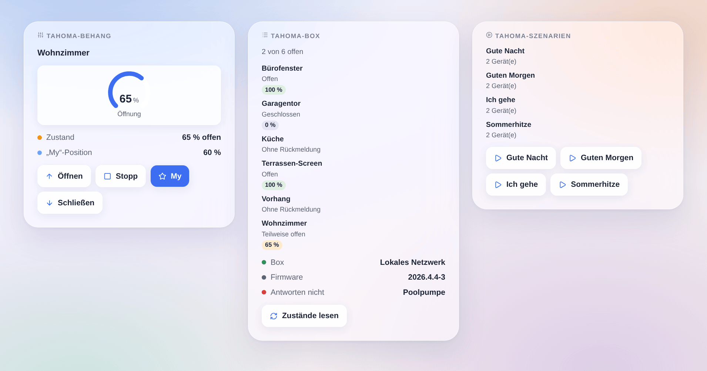

# Somfy TaHoma

## Überblick

Diese Integration bringt eine **Somfy-TaHoma-Box** (TaHoma, TaHoma Switch,
TaHoma Beecon, Connexoon) in Gladys: Rollläden, Jalousien, Screens,
Markisen, Vorhänge, Dachfenster, Pergolen, Garagentore und Tore
(io-homecontrol und RTS), Licht, Steckdosen und die Sensoren der Box.

Sie erreicht die Box auf zwei Wegen:

- **im lokalen Netzwerk**, über die lokale API des Somfy-Entwicklermodus:
  Befehle und Zustände laufen nicht mehr über Somfy und funktionieren ohne
  Internet;
- **über die Somfy-Cloud**, mit dem Konto der TaHoma-App.

Standardmäßig zuerst lokal, die Cloud als Ausweichlösung. Gladys zeigt an
jedem Gerät, welcher Weg genutzt wird.

Der Gladys-Store bietet bereits eine **Overkiz**-Integration (von cicoub13),
nur über die Cloud, die auch Atlantic-Cozytouch-, Flexom-, Rexel- und
Hitachi-Konten abdeckt. Diese hier ist den Somfy-Boxen gewidmet und ergänzt
den lokalen Modus.

Nicht mit Somfy verbunden.

## Voraussetzungen

- Gladys Assistant 5.3.0 oder neuer.
- Eine TaHoma-, TaHoma-Switch-, TaHoma-Beecon- oder Connexoon-Box, in der
  TaHoma-App eingerichtet.
- Für den lokalen Modus: eine mit dem Entwicklermodus kompatible Box (nicht
  die erste quadratische TaHoma, nicht das Connectivity Kit), im selben
  Netzwerk wie Gladys.
- Für die Cloud und die TaHoma-Szenarien: E-Mail-Adresse und Passwort der
  TaHoma-App.

## Konfiguration

### TaHoma-Konto

Wählen Sie die **Region** Ihres Kontos (für die meisten Europa), geben Sie
dann **E-Mail-Adresse** und **Passwort** der TaHoma-App ein und speichern
Sie. Gladys meldet sich einmal an und erneuert den Zugang danach selbst:
Somfy sperrt ein Konto, das sich zu oft anmeldet.

Das Konto ist optional, wenn Sie nur den lokalen Modus nutzen, wird aber für
die TaHoma-Szenarien und die Schaltfläche **Lokalen Modus aktivieren**
benötigt.

### Lokaler Modus

Am einfachsten: Konto speichern und dann auf **Lokalen Modus aktivieren**
drücken. Gladys schaltet den Entwicklermodus der Box ein, erstellt ein Token
namens „Gladys Assistant“ und wechselt ins lokale Netzwerk.

Von Hand: in der TaHoma-App unter **Installation konfigurieren › Parameter der
Box** 7-mal auf die PIN der Box tippen (etwa 1234-5678-9012), um den
**Entwicklermodus** zu öffnen, ein Token erstellen und unter **Lokales
Token** einfügen.

Gladys findet die Box selbst im Netzwerk (mDNS). Geben Sie ihre
**IP-Adresse** nur sonst ein (anderes Subnetz, Multicast gefiltert); eine
feste Adresse im Router ist am besten. Die **PIN der Box** braucht es nur
für ein Konto mit mehreren Boxen.

Der Schalter **Lokale Verbindung bevorzugen** von Gladys (standardmäßig an)
legt fest, welcher Weg zuerst versucht wird.

### Sprache

Gladys teilt der Integration bei einer Suche oder einer Szene Ihre Sprache
nicht mit: Wählen Sie die Sprache der Funktionsnamen und der
Szenen-Fehlermeldungen.

## Verwendung

### Geräte

Öffnen Sie den Tab **Erkennung**: Jedes Gerät der Box, das Gladys anzeigen
kann, erscheint mit dem Namen aus der TaHoma-App. Fügen Sie die gewünschten
hinzu.

| TaHoma-Gerät                                                   | In Gladys                                                                                                                                           |
| -------------------------------------------------------------- | --------------------------------------------------------------------------------------------------------------------------------------------------- |
| Rollladen, Jalousie, Screen, Fenster, Pergola, Garagentor, Tor | Rollladen: öffnen / stopp / schließen, Position, wenn der Motor sie meldet, Lamellen, wenn vorhanden                                                |
| Markise                                                        | Rollladen, Position = Ausfahrweite                                                                                                                  |
| Vorhang                                                        | Vorhang                                                                                                                                             |
| Antrieb mit einer Taste                                        | Rollladen, öffnen und schließen drücken die Taste                                                                                                   |
| RTS-Motor                                                      | Rollladen ohne Rückmeldung (RTS ist einseitig)                                                                                                      |
| Licht                                                          | Licht: ein / aus, Helligkeit, wenn dimmbar                                                                                                          |
| Steckdose, Relais, Pool                                        | Schalter                                                                                                                                            |
| Sensoren                                                       | Temperatur, Lichtstärke, Luftfeuchtigkeit, Öffnung, Bewegung, Rauch, Wasserleck, Batterie und schwache Batterie, CO2, Leistung, Energiezähler (kWh) |

Positionen geben an, wie weit geöffnet ist (100 % = offen), wie überall in
Gladys. Die Box meldet Änderungen selbst: Nichts wird abgefragt.

Batterien: Die meisten Geräte (solarbetriebene Velux-Rollläden, Sirenen,
IO-Sensoren) liefern keinen Prozentwert, nur eine Stufe in Worten. Die
Integration schätzt daraus einen Wert (gut oder voll 100 %, normal 75 %,
mittel 50 %, schwach 15 %, sehr schwach oder kritisch 5 %) und fügt einen
Sensor **Batterie schwach** hinzu, aktiv ab der Stufe schwach. Ein bereits in
Gladys angelegtes Gerät erhält diese Sensoren über **Aktualisieren** im
Erkennungsbildschirm.

Noch nicht unterstützt: Heizung (Thermostate, Ventile, Wärmepumpen), Alarme,
Kameras und Hue-Lampen hinter der Box.

### Transport

Jedes Gerät zeigt ein Abzeichen **lokal** oder **Cloud**. Ein **orangefarbener
Punkt** bedeutet, dass der bevorzugte Weg nicht antwortet und Gladys den
anderen nutzt: Der Tooltip nennt den Grund. Gladys versucht den bevorzugten
Weg alle 5 Minuten erneut.

Im lokalen Modus verlässt nichts Ihr Netzwerk, außer dem stündlichen Lesen
der TaHoma-Szenarien, wenn ein Konto eingetragen ist. Im Cloud-Modus laufen
Befehle und Zustände über Somfy.

### Widgets

- **TaHoma-Behang**: ein Behang, wie weit geöffnet, sein Zustand, Lamellen,
  „My“-Position und Batterie (Solarbehänge), mit den Tasten öffnen, stopp,
  „My“ und schließen.
- **TaHoma-Box**: die Behänge auf einen Blick, der genutzte Weg, die
  Firmware, stumme Geräte und eine Taste, um die Zustände neu zu lesen.
  Gladys zeigt höchstens acht Karten: darüber hinaus werden sieben Behänge
  gezeigt (die fahrenden und offenen zuerst) und die letzte Karte nennt die
  übrigen. Einstellung: die angezeigten Behänge, Namen durch Kommas getrennt,
  in dieser Reihenfolge.
- **TaHoma-Szenarien**: Ihre TaHoma-Szenarien und Tasten, um bis zu vier zu
  starten (Einstellung: Namen durch Kommas getrennt).

### Szenen-Auslöser

- **Ein TaHoma-Befehl ist fehlgeschlagen**: aus Gladys, der TaHoma-App oder
  einem Szenario; Variablen: Gerätename, Overkiz-Fehlercode, Name der
  Ausführung.
- **Ein TaHoma-Gerät antwortet nicht mehr oder wieder**: leere Batterie,
  Stromausfall, außer Reichweite.
- **Die TaHoma-Box ist weg oder zurück**: Kein Weg erreicht sie eine Minute
  lang, oder Somfy meldet sie offline.

### Szenen-Aktionen

- **TaHoma-Szenario starten**, über seinen Namen. Im lokalen Modus werden
  seine Befehle im lokalen Netzwerk wiedergegeben.
- **TaHoma-Befehl senden**: „My“, öffnen, schließen, stopp, identifizieren.

### Szenen-Beispiele

- Wenn die Box weg ist → eine Nachricht senden: „Die TaHoma-Box antwortet
  nicht mehr“.
- Wenn ein Befehl des Wohnzimmer-Rollladens fehlschlägt → mit dem Fehlercode
  benachrichtigen (ein Hindernis, ein festgefrorener Rollladen).
- Bei Sonnenuntergang → das TaHoma-Szenario „Gute Nacht“ starten.

## Fehlerbehebung

- **Verbindung testen** zeigt, welcher Weg antwortet und warum der andere
  nicht.
- „Somfy hat die E-Mail-Adresse oder das Passwort abgelehnt“: Prüfen Sie sie
  in der TaHoma-App. Nach vielen Fehlversuchen sperrt Somfy Anmeldungen eine
  Weile: Warten Sie vor einem neuen Versuch.
- „Box im lokalen Netzwerk nicht gefunden“: Geben Sie ihre IP-Adresse ein und
  prüfen Sie, ob der Entwicklermodus noch aktiv ist (ein Zurücksetzen oder
  manche Updates schalten ihn aus).
- „Die Box hat das lokale Token abgelehnt“: Das Token wurde widerrufen oder
  gehört zu einer anderen Box: Drücken Sie erneut auf Lokalen Modus
  aktivieren oder erstellen Sie ein neues.
- „Das Zertifikat ist nicht das einer TaHoma-Box“: Die Adresse ist nicht die
  Ihrer Box.
- Ein RTS-Motor zeigt keine Position: RTS ist einseitig, die Box kennt sie
  nicht.
- Logs: Tab Logs der Integration; fügen Sie dem Container
  `DEBUG=gladys-integration-sdk` hinzu, um die Details des SDK zu sehen.
  Melden Sie Probleme auf
  [GitHub](https://github.com/William-De71/gladys-somfy-tahoma/issues).
