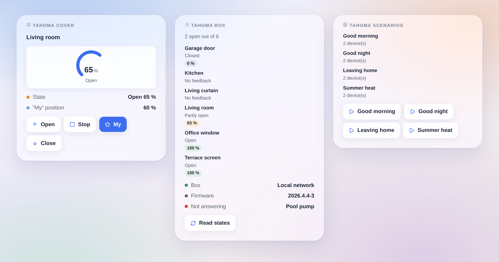

# Somfy TaHoma

## Overview

This integration brings a **Somfy TaHoma box** (TaHoma, TaHoma Switch, TaHoma
Beecon, Connexoon) into Gladys: roller shutters, blinds, screens, awnings,
curtains, roof windows, pergolas, garage doors and gates (io-homecontrol and
RTS), lights, plugs and the sensors of the box.

It reaches the box two ways:

- **on the local network**, through the local API of the Somfy Developer
  Mode: commands and states no longer go through Somfy and keep working
  without internet;
- **through the Somfy cloud**, with the account of the TaHoma app.

Local first by default, the cloud as the fallback. Gladys shows which one is
in use on every device.

The Gladys store already offers an **Overkiz** integration (by cicoub13),
cloud only, which also covers Atlantic Cozytouch, Flexom, Rexel and Hitachi
accounts. This one is dedicated to the Somfy boxes and adds the local mode.

Not affiliated with Somfy.

## Requirements

- Gladys Assistant 5.3.0 or later.
- A TaHoma, TaHoma Switch, TaHoma Beecon or Connexoon box set up in the
  TaHoma app.
- For the local mode: a box compatible with the Developer Mode (not the first
  square TaHoma, not the Connectivity Kit), on the same network as Gladys.
- For the cloud and the TaHoma scenarios: the e-mail and password of the
  TaHoma app.

## Configuration

### TaHoma account

Choose the **region** of your account (Europe for most users), then type the
**e-mail** and **password** of the TaHoma app and save. Gladys logs in once,
then renews its access by itself: Somfy blocks an account that logs in too
often.

The account is optional if you only use the local mode, but it is needed for
the TaHoma scenarios and for the **Enable the local mode** button.

### Local mode

The easiest way: save your account, then press **Enable the local mode**.
Gladys turns the Developer Mode of the box on and creates a token named
“Gladys Assistant”, then switches to the local network.

By hand: in the TaHoma app, **Configure the installation › parameters of the
box**, tap the PIN of the box (like 1234-5678-9012) 7 times to open the
**Developer Mode**, create a token and paste it in **Local token**.

Gladys finds the box on the network by itself (mDNS). Type its **IP
address** only if it does not (another subnet, multicast filtered); a fixed
address in your router is best. **PIN of the box** is only useful for an
account with several boxes.

The **Prefer the local connection** switch of Gladys (on by default) chooses
the channel tried first.

### Language

Gladys does not tell the integration your language when it scans or runs a
scene: choose the language of the feature names and of the scene errors.

## Usage

### Devices

Open the **Discover** tab: every device of the box that Gladys can show
appears, with the name given in the TaHoma app. Add the ones you want.

| TaHoma device                                                     | In Gladys                                                                                                 |
| ----------------------------------------------------------------- | --------------------------------------------------------------------------------------------------------- |
| Roller shutter, blind, screen, window, pergola, garage door, gate | Shutter: open / stop / close, position when the motor reports it, slats when it has some                  |
| Awning                                                            | Shutter, position = how far out                                                                           |
| Curtain                                                           | Curtain                                                                                                   |
| One-button opener                                                 | Shutter, open and close press the button                                                                  |
| RTS motor                                                         | Shutter without feedback (RTS is one-way)                                                                 |
| Light                                                             | Light: on / off, intensity when dimmable                                                                  |
| Plug, relay, pool                                                 | Switch                                                                                                    |
| Sensors                                                           | Temperature, light, humidity, opening, motion, smoke, water leak, battery, CO2, power, energy index (kWh) |

Positions count how open the cover is (100 % = open), like everywhere in
Gladys. The box pushes the changes: nothing is polled.

Not handled yet: heating (thermostats, valves, heat pumps), alarms, cameras
and Hue lamps behind the box.

### Transport

Each device shows a **local** or **cloud** badge. An **orange dot** means
the preferred channel does not answer and Gladys uses the other one: the
tooltip says why. Gladys tries the preferred channel again every 5 minutes.

In local mode, nothing leaves your network except the hourly reading of the
TaHoma scenarios when an account is set. In cloud mode, commands and states
go through Somfy.

### Widgets

- **TaHoma cover**: one cover, how open it is, its state, slats and “My”
  position, with the open, stop, “My” and close buttons.
- **TaHoma box**: the covers at a glance, the channel in use, the firmware,
  the devices not answering, and a button to read the states again.
- **TaHoma scenarios**: your TaHoma scenarios and buttons to run up to four
  of them (setting: names separated by commas).

### Scene triggers

- **A TaHoma command failed**: from Gladys, the TaHoma app or a scenario;
  variables: device name, Overkiz failure code, name of the execution.
- **A TaHoma device stops or resumes answering**: empty battery, power cut,
  out of range.
- **The TaHoma box is lost or back**: no channel reaches it for a minute, or
  Somfy says it is offline.

### Scene actions

- **Run a TaHoma scenario**, by its name. In local mode, its commands are
  replayed on the local network.
- **Send a TaHoma command**: “My”, open, close, stop, identify.

### Scene examples

- When the box is lost → send a message: “The TaHoma box no longer answers”.
- When a command of the living room shutter fails → notify with the failure
  code (an obstacle, a frozen shutter).
- At sunset → run the TaHoma scenario “Good night”.

## Troubleshooting

- **Test the connection** says which channel answers and why the other one
  does not.
- “Somfy refused the e-mail or the password”: check them in the TaHoma app.
  After many failures, Somfy blocks logins for a while: wait before retrying.
- “Box not found on the local network”: type its IP address, check that the
  Developer Mode is still on (a factory reset or some updates turn it off).
- “The box refused the local token”: the token was revoked or belongs to
  another box: press Enable the local mode again or create a new one.
- “The certificate is not the one of a TaHoma box”: the address is not the
  one of your box.
- An RTS motor shows no position: RTS is one-way, the box does not know it.
- Logs: Logs tab of the integration; add `DEBUG=gladys-integration-sdk` to
  the container for the SDK details. Report issues on
  [GitHub](https://github.com/William-De71/gladys-somfy-tahoma/issues).
