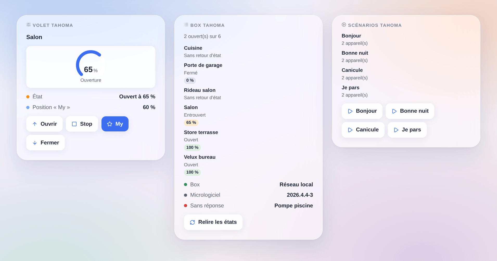

# Somfy TaHoma

## Présentation

Cette intégration amène une **box Somfy TaHoma** (TaHoma, TaHoma Switch,
TaHoma Beecon, Connexoon) dans Gladys : volets roulants, stores, screens,
stores bannes, rideaux, fenêtres de toit, pergolas, portes de garage et
portails (io-homecontrol et RTS), lumières, prises et capteurs de la box.

Elle joint la box de deux façons :

- **sur le réseau local**, par l’API locale du mode développeur Somfy :
  commandes et états ne passent plus par Somfy et fonctionnent sans internet ;
- **via le cloud Somfy**, avec le compte de l’application TaHoma.

En local d’abord par défaut, le cloud en repli. Gladys affiche celui qui est
utilisé sur chaque appareil.

Le store de Gladys propose déjà une intégration **Overkiz** (de cicoub13), en
cloud seulement, qui couvre aussi les comptes Atlantic Cozytouch, Flexom,
Rexel et Hitachi. Celle-ci est dédiée aux box Somfy et ajoute le mode local.

Sans lien avec Somfy.

## Prérequis

- Gladys Assistant 5.3.0 ou plus récent.
- Une box TaHoma, TaHoma Switch, TaHoma Beecon ou Connexoon installée dans
  l’application TaHoma.
- Pour le mode local : une box compatible avec le mode développeur (pas la
  première TaHoma carrée, pas le kit de connectivité), sur le même réseau que
  Gladys.
- Pour le cloud et les scénarios TaHoma : l’e-mail et le mot de passe de
  l’application TaHoma.

## Configuration

### Compte TaHoma

Choisissez la **région** de votre compte (Europe pour la plupart), puis
saisissez l’**e-mail** et le **mot de passe** de l’application TaHoma et
enregistrez. Gladys se connecte une fois, puis renouvelle son accès toute
seule : Somfy bloque un compte qui se connecte trop souvent.

Le compte est facultatif si vous n’utilisez que le mode local, mais il est
nécessaire pour les scénarios TaHoma et pour le bouton **Activer le mode
local**.

### Mode local

Le plus simple : enregistrez votre compte, puis appuyez sur **Activer le mode
local**. Gladys allume le mode développeur de la box et crée un jeton nommé
« Gladys Assistant », puis passe sur le réseau local.

À la main : dans l’application TaHoma, **Configurer l’installation ›
paramètres de la box**, touchez 7 fois le PIN de la box (du type
1234-5678-9012) pour ouvrir le **mode développeur**, créez un jeton et
collez-le dans **Jeton local**.

Gladys trouve la box toute seule sur le réseau (mDNS). Saisissez son
**adresse IP** seulement sinon (autre sous-réseau, multicast filtré) ; une
adresse fixe dans votre routeur est préférable. Le **PIN de la box** ne sert
que pour un compte avec plusieurs box.

L’interrupteur **Préférer la connexion locale** de Gladys (activé par défaut)
choisit le canal essayé en premier.

### Langue

Gladys ne transmet pas votre langue à l’intégration lors d’une recherche ou
d’une scène : choisissez la langue des noms de fonctionnalités et des erreurs
de scène.

## Utilisation

### Appareils

Ouvrez l’onglet **Découverte** : chaque appareil de la box que Gladys sait
afficher apparaît, avec le nom donné dans l’application TaHoma. Ajoutez ceux
que vous voulez.

| Appareil TaHoma                                                          | Dans Gladys                                                                                                                                     |
| ------------------------------------------------------------------------ | ----------------------------------------------------------------------------------------------------------------------------------------------- |
| Volet roulant, store, screen, fenêtre, pergola, porte de garage, portail | Volet : ouvrir / stop / fermer, position quand le moteur la donne, lames s’il en a                                                              |
| Store banne                                                              | Volet, position = déploiement                                                                                                                   |
| Rideau                                                                   | Rideau                                                                                                                                          |
| Ouvrant à un seul bouton                                                 | Volet, ouvrir et fermer appuient sur le bouton                                                                                                  |
| Moteur RTS                                                               | Volet sans retour d’état (le RTS est à sens unique)                                                                                             |
| Lumière                                                                  | Lumière : marche / arrêt, intensité si variable                                                                                                 |
| Prise, relais, piscine                                                   | Interrupteur                                                                                                                                    |
| Capteurs                                                                 | Température, luminosité, humidité, ouverture, mouvement, fumée, fuite d’eau, batterie et batterie faible, CO2, puissance, index d’énergie (kWh) |

Les positions indiquent l’ouverture (100 % = ouvert), comme partout dans
Gladys. La box pousse les changements : rien n’est interrogé en boucle.

Batteries : la plupart des appareils (volets Velux solaires, sirènes,
capteurs IO) ne donnent pas de pourcentage, seulement un niveau en mots.
L’intégration en tire une estimation (bon ou plein 100 %, normal 75 %,
moyen 50 %, faible 15 %, très faible ou critique 5 %) et ajoute un capteur
**Batterie faible**, allumé dès que le niveau est faible. Un appareil déjà
créé dans Gladys reçoit ces capteurs avec **Mettre à jour** dans l’écran de
découverte.

Pas encore gérés : le chauffage (thermostats, vannes, pompes à chaleur), les
alarmes, les caméras et les lampes Hue derrière la box.

### Transport

Chaque appareil affiche un badge **local** ou **cloud**. Un **point orange**
signifie que le canal préféré ne répond pas et que Gladys utilise l’autre :
l’infobulle en donne la raison. Gladys réessaie le canal préféré toutes les
5 minutes.

En mode local, rien ne sort de votre réseau, sauf la lecture horaire des
scénarios TaHoma si un compte est saisi. En mode cloud, commandes et états
passent par Somfy.

### Widgets

- **Volet TaHoma** : un volet, son ouverture, son état, ses lames et sa
  position « My », avec les boutons ouvrir, stop, « My » et fermer.
- **Box TaHoma** : les volets d’un coup d’œil, le canal utilisé, le
  micrologiciel, les appareils muets, et un bouton pour relire les états.
  Gladys affiche huit cartes au plus : au-delà, sept volets sont montrés (ceux
  qui bougent ou sont ouverts d’abord) et la dernière carte nomme les autres.
  Réglage : les volets à afficher, noms séparés par des virgules, dans cet
  ordre.
- **Scénarios TaHoma** : vos scénarios TaHoma et des boutons pour en lancer
  jusqu’à quatre (réglage : noms séparés par des virgules).

### Déclencheurs de scène

- **Une commande TaHoma a échoué** : depuis Gladys, l’application TaHoma ou un
  scénario ; variables : nom de l’appareil, code d’échec Overkiz, nom de
  l’exécution.
- **Un appareil TaHoma ne répond plus ou répond à nouveau** : pile vide,
  coupure de courant, hors de portée.
- **La box TaHoma est perdue ou revenue** : aucun canal ne la joint pendant
  une minute, ou Somfy la dit hors ligne.

### Actions de scène

- **Lancer un scénario TaHoma**, par son nom. En mode local, ses commandes
  sont rejouées sur le réseau local.
- **Envoyer une commande TaHoma** : « My », ouvrir, fermer, stop, identifier.

### Exemples de scènes

- Quand la box est perdue → envoyer un message : « La box TaHoma ne répond
  plus ».
- Quand une commande du volet du salon échoue → prévenir avec le code d’échec
  (un obstacle, un volet gelé).
- Au coucher du soleil → lancer le scénario TaHoma « Bonne nuit ».

## Dépannage

- **Tester la connexion** indique quel canal répond et pourquoi l’autre ne
  répond pas.
- « Somfy a refusé l’e-mail ou le mot de passe » : vérifiez-les dans
  l’application TaHoma. Après de nombreux échecs, Somfy bloque les connexions
  un moment : attendez avant de réessayer.
- « Box introuvable sur le réseau local » : saisissez son adresse IP,
  vérifiez que le mode développeur est toujours actif (une remise à zéro ou
  certaines mises à jour le coupent).
- « La box a refusé le jeton local » : le jeton a été révoqué ou appartient à
  une autre box : appuyez à nouveau sur Activer le mode local ou créez-en un
  nouveau.
- « Le certificat n’est pas celui d’une box TaHoma » : l’adresse n’est pas
  celle de votre box.
- Un moteur RTS n’affiche pas de position : le RTS est à sens unique, la box
  ne la connaît pas.
- Journaux : onglet Logs de l’intégration ; ajoutez
  `DEBUG=gladys-integration-sdk` au conteneur pour le détail du SDK. Signalez
  les problèmes sur
  [GitHub](https://github.com/William-De71/gladys-somfy-tahoma/issues).
